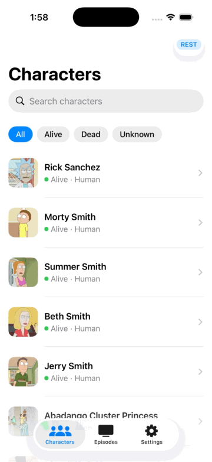
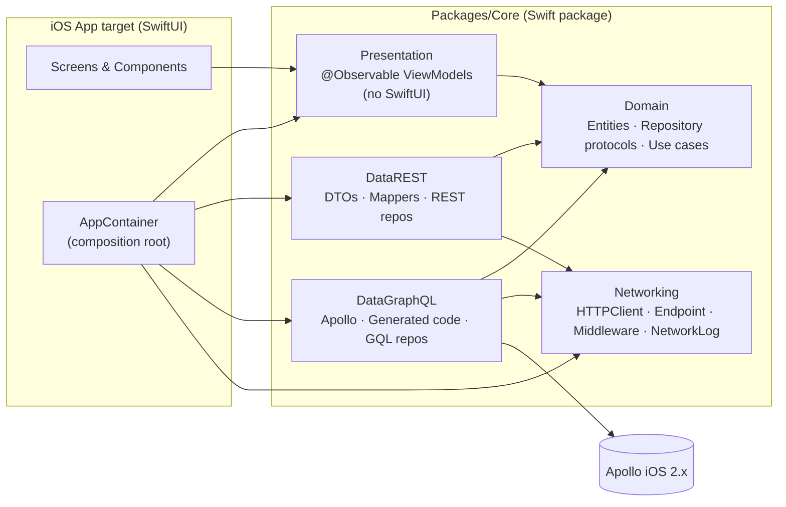

# RickVerse

**One SwiftUI app, one backend, two APIs.** RickVerse browses the Rick and Morty universe through
**REST** (a hand-written `URLSession` client) *or* **GraphQL** (Apollo iOS 2.x), switchable at
runtime. Both sit behind the same Domain protocols, so the screens never know which one is talking.

[](https://github.com/roldanmatias/rick-verse/actions/workflows/ci.yml)
[](https://github.com/roldanmatias/rick-verse/actions/workflows/lint.yml)
[](https://github.com/roldanmatias/rick-verse/actions/workflows/codeql.yml)
[](https://roldanmatias.github.io/rick-verse/)


<p align="center"></p>

## What this project demonstrates

- **Clean Architecture enforced by the compiler.** Five modules in a local Swift package. ViewModels can't import SwiftUI, DTOs, or Apollo, because those modules aren't their dependencies.
- **A REST client from first principles.** A typed `Endpoint`, a middleware chain (headers, logging, metrics, retry with backoff + jitter + `Retry-After`, single-flight token refresh), and typed throws end to end.
- **GraphQL with Apollo iOS 2.x.** Codegen kept `internal`, custom interceptors, a normalized cache with resolved keys, four cache policies, and stale-while-revalidate streaming.
- **The N+1 problem, measured.** A character detail costs 52 → 2 → 1 → 0 requests (naive REST → batch REST → GraphQL → GraphQL cache), with a live in-app network log to prove it.
- **Concurrency done carefully.** Debounced search, stale-response protection, cancellation that never surfaces as an error, bounded `TaskGroup` fan-out, and actors.
- **A real test pyramid.** About 210 hermetic package tests built on real API fixtures, 3 stubbed UI tests, and gated live contract and benchmark suites.

## Architecture



**The dependency rule:** arrows point inward, toward Domain. Domain imports nothing. Only the app target knows every module, because it wires them together.

| Module | Responsibility | Depends on |
|---|---|---|
| `Domain` | Entities, repository protocols, use cases, `DomainError` | — |
| `Networking` | `HTTPClient`, `Endpoint`, middleware chain, `NetworkLog` | — |
| `DataREST` | DTOs mirroring the JSON, mappers, quirk handling, REST repositories | Domain, Networking |
| `DataGraphQL` | `.graphql` operations, generated code (`internal`), interceptors, GraphQL repositories | Domain, Networking, Apollo |
| `Presentation` | `@Observable` ViewModels, a shared `Paginator` | Domain |
| App target | SwiftUI screens, design system, navigation, `AppContainer` | everything |

## REST vs GraphQL, measured

Rick Sanchez's detail (51 episodes), live API, 5 runs averaged. Full table and method: [`docs/benchmark.md`](docs/benchmark.md).

| | REST naive | REST batch | GraphQL | GraphQL (cache) |
|---|---|---|---|---|
| Requests | 52 | 2 | 1 | 0 |
| Time | ~21 s ¹ | **191 ms** | 751 ms | 75 ms |
| Bytes | 71 KB | 71 KB | **6.1 KB** | 0 |

**The takeaway.** REST with a batch endpoint wins on latency: GraphQL moves N+1 to the server, it doesn't remove it. GraphQL wins on payload size (11× smaller), round trips, and client-side caching.

¹ The naive approach hits the API's rate limit (`429`) even sequentially, and retry backoff dominates the time. N+1 doesn't just make you slower, it gets you throttled.

## Key decisions

| ADR | Decision |
|---|---|
| [0001](docs/adr/0001-modular-clean-architecture-local-package.md) | Modular Clean Architecture in a local Swift package |
| [0002](docs/adr/0002-typed-throws-closed-domain-error.md) | Typed throws with a closed `DomainError` |
| [0003](docs/adr/0003-viewmodels-without-swiftui.md) | ViewModels without SwiftUI; Views in the app target |
| [0004](docs/adr/0004-one-repository-protocol-two-apis.md) | REST and GraphQL behind one repository protocol, chosen at the composition root |
| [0005](docs/adr/0005-apollo-generated-code-internal.md) | Apollo generated code embedded and `internal` to `DataGraphQL` |
| [0006](docs/adr/0006-partial-graphql-data-policy.md) | Partial GraphQL data: skip invalid list items, fail an invalid detail subject |
| [0007](docs/adr/0007-hand-written-networking.md) | Hand-written networking instead of Alamofire |

## How to run

Requirements: Xcode 26, iOS 17+ simulator or device.

```bash
open RickVerse.xcworkspace          # run the RickVerse scheme
make test                           # package tests (~210, about 1 s, no simulator needed)
make graphql                        # download the schema and regenerate Apollo code
make graphql-generate               # regenerate from the committed schema (offline)
```

Live suites (they hit the public API, so don't loop them):

```bash
cd Packages/Core
RUN_CONTRACT_TESTS=1 swift test --filter ContractTests     # the API still behaves the way our code assumes
RUN_BENCHMARKS=1 BENCHMARK_OUTPUT=$PWD/bench.md swift test --filter BenchmarkTests   # ~8 minutes
```

UI tests run against in-memory stubs (the `-uiTesting` launch argument), so they're hermetic.

📚 **API docs (DocC):** [roldanmatias.github.io/rick-verse](https://roldanmatias.github.io/rick-verse/)

## CI/CD

Every PR goes through three tiers. CI runs exactly the `make` targets you run locally.

| Tier | Workflows | Runner |
|---|---|---|
| Cheap, fast checks | SwiftLint · swift-format · architecture fitness function · semantic PR title + module labels | Linux |
| Build & test | Package tests + 80% coverage gate + explicit-dependency check → app build + stubbed UI tests (`.xcresult` uploaded on failure) | macOS 26 |
| Not blocking PRs | Nightly live contract tests + GraphQL schema-drift issue · CodeQL (Swift + workflows) · DocC → Pages via OIDC · tag → GitHub Release grouped by layer · on-demand benchmark | macOS / Linux |

```bash
make lint      # SwiftLint + swift-format (strict)
make arch      # layer import rules (fails if, say, a ViewModel imports SwiftUI)
make coverage  # tests + coverage gate
make docs      # DocC for every Core module
```

## Known limitations

- **Read-only API.** There are no mutations or subscriptions, so cache updates after writes and optimistic UI are covered in theory only.
- **`AsyncImage` caching** relies on `URLCache` (50 MB memory / 200 MB disk). There's no decoded-image cache or prefetching.
- **The GraphQL cache is in memory.** Apollo's SQLite cache would add offline cold starts.
- **The benchmark ran from a Mac on Wi-Fi**, not a device on cellular. The ratios are the point, not the absolute times.

## What I'd do next

Persistent cache (`ApolloSQLite`) with an eviction policy · prefetching images ahead of scroll · request coalescing for identical in-flight REST calls · a mutation flow against a writable API to show optimistic updates and cache writes.

---

Data from [rickandmortyapi.com](https://rickandmortyapi.com). Not affiliated with Adult Swim.
