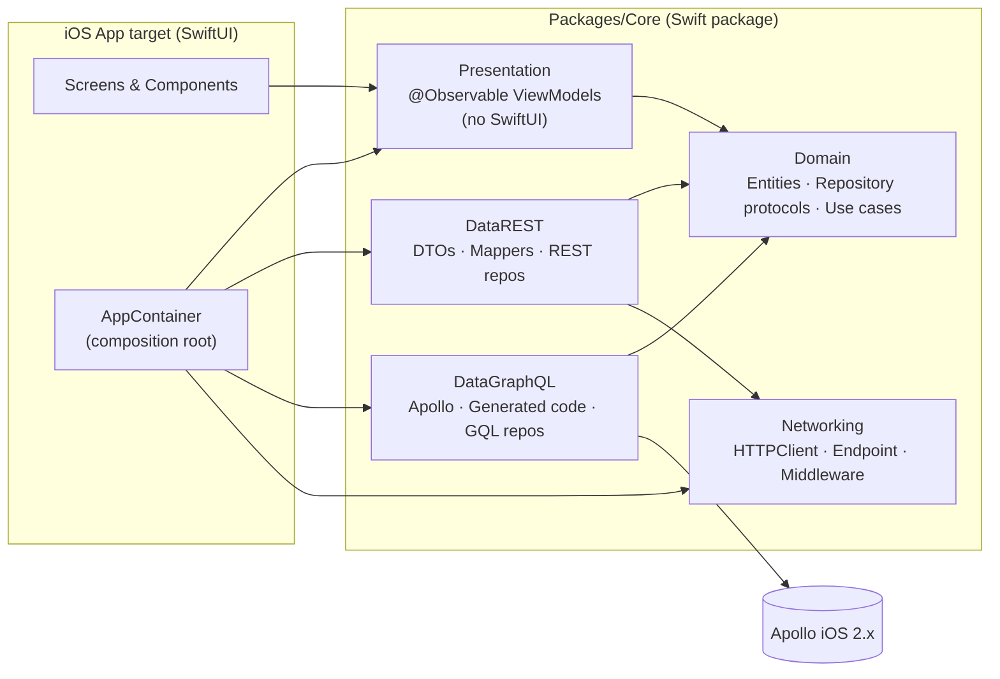

# RickVerse — Build Guide

> A SwiftUI iOS app that talks to the **same backend through two different APIs**: **REST** (hand-written `URLSession` client) and **GraphQL** (Apollo iOS 2.x). Both sit behind one Domain protocol, so the app can switch between them at runtime.
>
> **Goal:** become an expert in calling backend services with REST and GraphQL, using Clean Architecture + MVVM in Swift 6, and have a portfolio project you can defend line by line with a senior iOS interviewer.

**How to use this guide**

- Work through the phases in order. Each phase has **Theory → Build → Done when → Commit**.
- The code blocks are **reference snippets**, there to unblock the non-obvious parts. Type every file yourself. Don't copy and paste, because typing it is how you learn it.
- Every phase ends with a commit (or a PR into `main`). A clean history is part of what interviewers look at.
- Write the "Interview angle" notes from each phase into `docs/notes.md` in your own words.

---

## Table of contents

0. [The finished project](#0-the-finished-project)
1. [Phase 0 — Repo, Xcode project, local package](#phase-0--repo-xcode-project-local-package)
2. [Phase 1 — Domain layer](#phase-1--domain-layer)
3. [Phase 2 — REST theory + Networking module](#phase-2--rest-theory--networking-module)
4. [Phase 3 — DataREST: DTOs, mapping, repositories](#phase-3--datarest-dtos-mapping-repositories)
5. [Phase 4 — ViewModels (package) + Cast List screen (app)](#phase-4--viewmodels-package--cast-list-screen-app)
6. [Phase 5 — Detail + Episodes: the N+1 problem in REST](#phase-5--detail--episodes-the-n1-problem-in-rest)
7. [Phase 6 — GraphQL theory + Apollo setup + codegen](#phase-6--graphql-theory--apollo-setup--codegen)
8. [Phase 7 — DataGraphQL repositories + runtime switch](#phase-7--datagraphql-repositories--runtime-switch)
9. [Phase 8 — Apollo advanced: cache, policies, interceptors, network log](#phase-8--apollo-advanced-cache-policies-interceptors-network-log)
10. [Phase 9 — Testing strategy + CI](#phase-9--testing-strategy--ci)
11. [Phase 10 — Polish for interviewers](#phase-10--polish-for-interviewers)
12. [Phase 11 — GitHub Actions: the CI/CD pipeline](#phase-11--github-actions-the-cicd-pipeline)
13. [Screens & interactions spec](#screens--interactions-spec)
14. [Interview question bank](#interview-question-bank)

---

## 0. The finished project

### What the app does

| Tab | Screens | What it demonstrates |
|---|---|---|
| **Characters** | Searchable, filterable, infinitely scrolling list → Character detail with episodes | Pagination, debounced search, cancellation, the N+1 problem |
| **Episodes** | List grouped by season → Episode detail with a grid of characters | Batching in REST vs a nested query in GraphQL |
| **Settings** | Data source switch (REST / GraphQL), cache policy, network log, clear cache | Runtime swapping of the Data layer, observability |

### The backend

The **Rick and Morty API**, which is free, needs no API key, and exposes both styles:

- REST: `https://rickandmortyapi.com/api`
- GraphQL: `https://rickandmortyapi.com/graphql`

Same data, two APIs. That makes it a fair comparison.

### Architecture



**The dependency rule:** arrows point inward, toward Domain. Domain imports nothing. Presentation knows Domain only, so it never sees DTOs, `URLSession` or Apollo. Only the **app target** knows every module, because it has to wire them together.

### Final folder structure

```
RickVerse/
├── README.md
├── .gitignore
├── Makefile                      ← same commands locally and in CI (Phase 11)
├── .swiftlint.yml
├── .swift-format
├── scripts/                      ← check-architecture.sh, coverage.sh, pick-simulator.sh
├── .github/                      ← Phase 11
│   ├── actions/setup-xcode/action.yml
│   ├── workflows/                ← ci, lint, pr-hygiene, graphql, contract, codeql, docs, release, benchmark
│   ├── dependabot.yml
│   ├── labeler.yml
│   ├── release.yml
│   ├── CODEOWNERS
│   └── pull_request_template.md
├── docs/
│   ├── GUIDE.md                  ← this file
│   ├── notes.md                  ← your interview notes
│   ├── benchmark.md              ← REST vs GraphQL numbers
│   ├── adr/                      ← Architecture Decision Records
│   └── screenshots/
├── RickVerse.xcodeproj
├── RickVerse/                    ← iOS APP TARGET — all SwiftUI lives here
│   ├── App/
│   │   ├── RickVerseApp.swift
│   │   ├── AppContainer.swift
│   │   ├── DataSource.swift
│   │   └── ViewModelFactory.swift
│   ├── Navigation/
│   │   ├── Route.swift
│   │   └── RootTabView.swift
│   ├── Features/
│   │   ├── CastList/      CastListScreen.swift, CastRow.swift, StatusFilterBar.swift
│   │   ├── CastDetail/    CastDetailScreen.swift, DetailHeader.swift, EpisodeRow.swift
│   │   ├── Episodes/      EpisodeListScreen.swift, EpisodeDetailScreen.swift
│   │   └── Settings/      SettingsScreen.swift, NetworkLogScreen.swift
│   ├── DesignSystem/
│   │   ├── AvatarImage.swift
│   │   ├── StatusBadge.swift
│   │   ├── ErrorStateView.swift
│   │   ├── PaginationFooter.swift
│   │   └── DomainError+Message.swift
│   └── Resources/Assets.xcassets
└── Packages/Core/
    ├── Package.swift
    ├── apollo-codegen-config.json
    ├── GraphQL/                  ← schema + .graphql operations (input to codegen)
    │   ├── schema.graphqls
    │   ├── typePolicies.graphqls
    │   └── Operations/
    │       ├── Fragments.graphql
    │       ├── Characters.graphql
    │       └── Episodes.graphql
    ├── Sources/
    │   ├── Domain/
    │   ├── Networking/
    │   ├── DataREST/
    │   ├── DataGraphQL/
    │   │   ├── Generated/        ← codegen output (committed)
    │   │   ├── Client/
    │   │   ├── Mappers/
    │   │   └── Repositories/
    │   └── Presentation/         ← ViewModels only. `import SwiftUI` is forbidden here.
    └── Tests/
        ├── TestSupport/          ← URLProtocolStub, fixtures loader (shared)
        ├── DomainTests/
        ├── NetworkingTests/
        ├── DataRESTTests/Fixtures/*.json
        ├── DataGraphQLTests/Fixtures/*.json
        └── PresentationTests/
```

### Why ViewModels live in the package but Views don't

| Decision | Reason you give in an interview |
|---|---|
| ViewModels in `Presentation` (package), importing only `Foundation` + `Observation` | They become **platform-agnostic, testable with `swift test` on macOS**, and reusable by a widget, a watch app or a macOS target. The compiler stops a ViewModel from reaching into SwiftUI. |
| SwiftUI Views in the app target | Views are the most volatile code and depend on the design system, assets and navigation, which all belong to the app. Keeping them out of the package means the package has no UI framework dependency. |
| Composition root in the app | It's the only place allowed to know concrete types (`RESTCastRepository`, `ApolloClient`). That's what makes the REST/GraphQL switch a one-line change. |

---

## Phase 0 — Repo, Xcode project, local package

### Build

1. Create the GitHub repo `RickVerse` (public, MIT license, Swift `.gitignore`). Clone it.
2. **Xcode → File → New → Project → iOS → App**
   - Product name `RickVerse`, Interface **SwiftUI**, Language **Swift**, Testing System **Swift Testing**, Storage **None**
   - Save it **inside** the cloned folder and uncheck "Create Git repository" (you already have one).
3. Target settings:
   - Minimum Deployments: **iOS 17.0**
   - Build Settings → **Swift Language Version: Swift 6**
   - Bundle ID: `com.<yourname>.RickVerse`
4. Create the package from Terminal:
   ```bash
   mkdir -p Packages/Core && cd Packages/Core
   swift package init --type library --name Core
   ```
   Then delete the generated sources and tests and create the folder structure above.
5. Write `Package.swift`. This is the full final version. Targets you haven't reached yet just get a placeholder `.swift` file, because SPM won't build a target with no sources.

```swift
// swift-tools-version: 6.0
import PackageDescription

let package = Package(
    name: "Core",
    // iOS is the real target. macOS 14 lets `swift test` run in Terminal/CI without a simulator.
    platforms: [.iOS(.v17), .macOS(.v14)],
    products: [
        .library(name: "Domain", targets: ["Domain"]),
        .library(name: "Networking", targets: ["Networking"]),
        .library(name: "DataREST", targets: ["DataREST"]),
        .library(name: "DataGraphQL", targets: ["DataGraphQL"]),
        .library(name: "Presentation", targets: ["Presentation"]),
    ],
    dependencies: [
        .package(url: "https://github.com/apollographql/apollo-ios.git", from: "2.0.0"),
        // DocC → GitHub Pages (Phase 11). Build-time plugin only; it adds nothing to the app.
        .package(url: "https://github.com/swiftlang/swift-docc-plugin", from: "1.4.0"),
    ],
    targets: [
        .target(name: "Domain"),
        .target(name: "Networking"),
        .target(name: "DataREST", dependencies: ["Domain", "Networking"]),
        .target(name: "DataGraphQL", dependencies: [
            "Domain",
            "Networking",   // for NetworkLog (Phase 8). Apollo types never leave this module.
            .product(name: "Apollo", package: "apollo-ios"),
            .product(name: "ApolloAPI", package: "apollo-ios"),
        ]),
        .target(name: "Presentation", dependencies: ["Domain"]),

        // Shared test helpers (URLProtocolStub, fixture loading). A normal target used only by tests.
        .target(name: "TestSupport", path: "Tests/TestSupport"),

        .testTarget(name: "DomainTests", dependencies: ["Domain"]),
        .testTarget(name: "NetworkingTests", dependencies: ["Networking", "TestSupport"]),
        .testTarget(name: "DataRESTTests",
                    dependencies: ["DataREST", "Networking", "TestSupport"],
                    resources: [.process("Fixtures")]),
        .testTarget(name: "DataGraphQLTests",
                    dependencies: ["DataGraphQL", "TestSupport",
                                   .product(name: "Apollo", package: "apollo-ios")],
                    resources: [.process("Fixtures")]),
        .testTarget(name: "PresentationTests", dependencies: ["Presentation", "Domain"]),

        // Live tests against the real API. Skipped unless RUN_CONTRACT_TESTS=1 (nightly CI, Phase 11).
        .testTarget(name: "ContractTests",
                    dependencies: ["Domain", "Networking", "DataREST", "DataGraphQL"]),
    ]
)
```

> Tip: comment out the Apollo and DocC dependencies, the `DataGraphQL` target and `ContractTests` until you reach them (Phases 6, 8 and 11), so early builds stay fast.
>
> **Commit `Package.resolved`.** RickVerse is an app, so it needs reproducible dependency versions. CI caching and Dependabot also rely on that file.

6. Add the package to the app: drag the `Packages/Core` folder into Xcode's project navigator. Then go to **App target → General → Frameworks, Libraries, and Embedded Content → +** and add `Domain`, `Networking`, `DataREST`, `Presentation` (and `DataGraphQL` in Phase 7).
7. Verify:
   ```bash
   cd Packages/Core && swift build && swift test
   ```
   and that the app builds in Xcode (⌘B).

### Done when
- [ ] `swift build` passes in `Packages/Core`
- [ ] The app target builds and links the package products
- [ ] `docs/GUIDE.md` (this file) is committed

**Commit:** `chore: bootstrap Xcode app and Core Swift package`

---

## Phase 1 — Domain layer

### Theory

- **Entity vs DTO.** An *entity* is the shape your app reasons about. A *DTO* (data transfer object) mirrors the server's JSON or GraphQL shape. REST and GraphQL return different shapes for the same character, and both map to **one entity**. That mapping is the whole reason this project works.
- **Repository protocol.** Domain declares *what* it needs (`cast(page:filter:)`), and the Data layers decide *how* to get it.
- **Use case.** One business action, such as "search the cast". It's thin today, but it's where rules like trimming, validation or combining repositories live, and it gives ViewModels a stable surface.
- **Typed throws** (`throws(DomainError)`). Every Data layer must translate `URLError`, `DecodingError` and Apollo errors into one closed enum, and ViewModels `switch` over it exhaustively.

### Build — files in `Sources/Domain/`

| File | Contents |
|---|---|
| `Entities/CastMember.swift` | `struct CastMember: Identifiable, Hashable, Sendable` with `id: Int`, `name`, `status: Status`, `species`, `imageURL: URL`. Nested `enum Status: String, CaseIterable, Sendable { case alive, dead, unknown }` |
| `Entities/CastMemberDetail.swift` | `member: CastMember`, `gender: String`, `originName: String`, `locationName: String`, `episodes: [Episode]` |
| `Entities/Episode.swift` | `id: Int`, `name`, `code` ("S01E01"), `season: Int`, `number: Int`, `airDate: Date?` |
| `Entities/EpisodeDetail.swift` | `episode: Episode`, `cast: [CastMember]` |
| `Entities/Page.swift` | `struct Page<Item: Sendable>: Sendable` with `items`, `nextPage: Int?`, computed `hasMore` |
| `Entities/CastFilter.swift` | `struct CastFilter: Equatable, Sendable` with `name: String?`, `status: CastMember.Status?` |
| `Errors/DomainError.swift` | `enum DomainError: Error, Equatable, Sendable { case offline, timeout, notFound, server, invalidData, cancelled, unknown }` |
| `Repositories/CastRepository.swift` | see below |
| `Repositories/EpisodeRepository.swift` | `episodes(page:)` and `detail(id:)` |
| `UseCases/*.swift` | `SearchCastUseCase`, `GetCastMemberDetailUseCase`, `GetEpisodesUseCase`, `GetEpisodeDetailUseCase` |

> ⚠️ Don't name the entity `Character`. It shadows `Swift.Character` and produces confusing compiler errors.

```swift
public protocol CastRepository: Sendable {
    func cast(page: Int, filter: CastFilter) async throws(DomainError) -> Page<CastMember>
    func detail(id: Int) async throws(DomainError) -> CastMemberDetail
}

public struct SearchCastUseCase: Sendable {
    private let repository: any CastRepository
    public init(repository: any CastRepository) { self.repository = repository }

    public func callAsFunction(filter: CastFilter, page: Int = 1) async throws(DomainError) -> Page<CastMember> {
        var normalized = filter
        let trimmed = filter.name?.trimmingCharacters(in: .whitespacesAndNewlines) ?? ""
        normalized.name = trimmed.isEmpty ? nil : trimmed
        return try await repository.cast(page: page, filter: normalized)
    }
}
```

### Tests (`DomainTests`, Swift Testing)

Write a `StubCastRepository` that **records** the arguments it receives. Then prove:
- `"   "` → `filter.name == nil`
- `" rick "` → `"rick"`
- the status filter passes through untouched
- a thrown `DomainError.offline` reaches the caller unchanged
- use `@Test(arguments:)` for the trimming cases (parameterized tests are a nice touch)

### Interview angle
> *"Your use case only trims a string and forwards. Isn't that over-engineering?"*
> A strong answer covers four things: a stable seam for ViewModels, one obvious place for business rules as they grow, testability, and honesty about the trade-off ("in a tiny app I'd consider letting ViewModels call repositories directly, and here's how I'd decide").

**Commit:** `feat(domain): entities, repository protocols, use cases`

---

## Phase 2 — REST theory + Networking module

### Theory you must be able to explain

| Topic | Key points |
|---|---|
| **Resources & methods** | URLs identify resources. `GET` reads, `POST` creates, `PUT` replaces, `PATCH` partially updates, `DELETE` removes. |
| **Idempotency & safety** | `GET`, `HEAD`, `PUT` and `DELETE` are idempotent, so repeating them has the same effect. `POST` is not, so **never auto-retry a POST** without an idempotency key. |
| **Status codes** | 2xx success · 3xx redirect · 4xx client error (don't retry, except **408** and **429**) · 5xx server error (retry with backoff). |
| **Headers** | `Accept`, `Content-Type`, `Authorization: Bearer …`, `User-Agent`, `Retry-After`, `ETag`/`If-None-Match`, `Cache-Control`. |
| **HTTP caching** | `URLCache` honors `Cache-Control`/`ETag`. A `304 Not Modified` saves bandwidth. Know when to set `requestCachePolicy`. |
| **Pagination styles** | Page number (this API), offset/limit, cursor (stable under inserts, used by GraphQL Relay connections). |
| **Retry with exponential backoff + jitter** | `delay = base * 2^attempt`, randomized so thousands of clients don't retry in sync (the "thundering herd"). |
| **Cancellation** | `URLSession` async APIs respect Task cancellation. SwiftUI's `.task` cancels when the view disappears. A cancelled request is **not an error to show the user**. |
| **Auth token refresh** | When several requests get a 401 at once, refresh **once** (single-flight) using an `actor`. This is a classic senior question. |

### Build — `Sources/Networking/`

| File | Responsibility |
|---|---|
| `HTTPMethod.swift` | `enum HTTPMethod: String, Sendable { case get = "GET", post = "POST", put = "PUT", patch = "PATCH", delete = "DELETE" }` plus `var isIdempotent: Bool` |
| `Endpoint.swift` | Generic description of a request, typed by its response |
| `NetworkError.swift` | Transport-level errors (no Domain knowledge) |
| `HTTPClient.swift` | Protocol: `send(_:) async throws(NetworkError) -> Response` |
| `URLSessionHTTPClient.swift` | Implementation: builds the `URLRequest`, runs the middleware chain, validates the status, decodes |
| `RequestMiddleware.swift` | Protocol for the interceptor chain (like Dio interceptors) |
| `Middlewares/DefaultHeadersMiddleware.swift` | `Accept: application/json`, `User-Agent: RickVerse/1.0 (iOS)` |
| `Middlewares/LoggingMiddleware.swift` | `os.Logger`: method, URL, status, duration. Never log tokens. |
| `Middlewares/RetryMiddleware.swift` | Backoff + jitter, idempotent methods only, 5xx/408/429/timeout, honors `Retry-After`, stops on cancellation |
| `Middlewares/MetricsMiddleware.swift` | Records each request into `NetworkLog` (Phase 8) |
| `Middlewares/AuthMiddleware.swift` + `TokenStore.swift` (actor) | **Exercise only** (this API has no auth): attach a bearer token, refresh once on 401, retry the original request. Tested with fakes. |
| `JSONDecoder+RickVerse.swift` | Decoder with a date strategy that handles fractional seconds |

Reference — the core types:

```swift
public struct Endpoint<Response: Decodable & Sendable>: Sendable {
    public var path: String
    public var method: HTTPMethod = .get
    public var queryItems: [URLQueryItem] = []
    public var headers: [String: String] = [:]
    public var body: Data? = nil
    public init(path: String, method: HTTPMethod = .get, queryItems: [URLQueryItem] = [],
                headers: [String: String] = [:], body: Data? = nil) { /* assign */ }
}

public enum NetworkError: Error, Equatable, Sendable {
    case invalidRequest
    case offline
    case timeout
    case cancelled
    case http(status: Int, body: Data)
    case decoding(String)
    case transport(String)
}

public protocol HTTPClient: Sendable {
    func send<Response>(_ endpoint: Endpoint<Response>) async throws(NetworkError) -> Response
}

public typealias NextHandler = @Sendable (URLRequest) async throws -> (Data, HTTPURLResponse)

public protocol RequestMiddleware: Sendable {
    func intercept(_ request: URLRequest, next: NextHandler) async throws -> (Data, HTTPURLResponse)
}
```

Reference — building the chain. This is the same pattern as Dio interceptors and Apollo's request chain:

```swift
// inside URLSessionHTTPClient (make it a struct so Sendable conformance is automatic)
private func execute(_ request: URLRequest) async throws -> (Data, HTTPURLResponse) {
    let session = self.session
    let terminal: NextHandler = { request in
        let (data, response) = try await session.data(for: request)
        guard let http = response as? HTTPURLResponse else { throw URLError(.badServerResponse) }
        return (data, http)
    }
    // First middleware in the array runs first.
    let chain = middlewares.reversed().reduce(terminal) { next, middleware -> NextHandler in
        { request in try await middleware.intercept(request, next: next) }
    }
    return try await chain(request)
}
```

Map errors in **one** place (`NetworkError.init(_ error: any Error)`):

| Source | → `NetworkError` |
|---|---|
| `CancellationError`, `URLError.cancelled` | `.cancelled` |
| `URLError.notConnectedToInternet`, `.networkConnectionLost`, `.dataNotAllowed` | `.offline` |
| `URLError.timedOut` | `.timeout` |
| non-2xx status | `.http(status:body:)` |
| `DecodingError` | `.decoding(String(describing:))`. Log the full error, because it names the failing key path. |

**Gotcha you'll hit:** the API's `created` field looks like `2017-11-04T18:48:46.250Z`. `JSONDecoder.dateDecodingStrategy = .iso8601` **fails on fractional seconds**. Write a `.custom` strategy using `Date.ISO8601FormatStyle(includingFractionalSeconds: true)`. Interviewers love this one.

**`RetryMiddleware` spec**
- `maxAttempts = 3`, `baseDelay = 0.5s`, delay = `random(0...base * 2^attempt)` (full jitter)
- Retry only if `HTTPMethod(rawValue: request.httpMethod)?.isIdempotent == true`
- Retry on 408, 429, 5xx, `URLError.timedOut`, `.networkConnectionLost`
- If a `Retry-After` header is present (seconds), use it instead
- Inject the sleeping function (`@Sendable (Duration) async throws -> Void`) so tests run instantly
- `try Task.checkCancellation()` before every retry

### Tests (`NetworkingTests`)
Build `URLProtocolStub` in `TestSupport`. It's a `URLProtocol` subclass that returns canned `(Data, HTTPURLResponse)` or an error per request, and records the requests it received. Create the session with `URLSessionConfiguration.ephemeral` and `protocolClasses = [URLProtocolStub.self]`.

Test:
- the URL is built correctly (path + query items, percent-encoding of `"Rick Sanchez"`)
- the default headers are present
- 200 → decoded value; 404 → `.http(status: 404, …)`; bad JSON → `.decoding`
- retry: 503, 503, 200 → success after 3 calls; a 400 is **not** retried; a `POST` is **not** retried
- cancellation: cancelling the Task yields `.cancelled` and no retry

> Run the `URLProtocolStub` tests serialized (`@Suite(.serialized)`), because the stub has shared static state.

**Commit:** `feat(networking): URLSession HTTP client with middleware chain and retry`

---

## Phase 3 — DataREST: DTOs, mapping, repositories

### The REST endpoints you'll use

| Need | Request | Notes |
|---|---|---|
| List / search characters | `GET /character?page=2&name=rick&status=alive` | 20 per page. `info.next` is a **full URL string** (or `null`). |
| Character detail | `GET /character/2` | `episode` is an **array of URLs**, not objects |
| Several episodes at once | `GET /episode/1,2,3` | Batch endpoint. Returns an **array**. |
| Episodes list | `GET /episode?page=1` | `episode` field = "S01E01", `air_date` = "December 2, 2013" |
| Several characters | `GET /character/1,2,3` | Batch endpoint |

**Real-world quirks to handle (and mention in interviews):**
1. **A search with no matches returns `404 {"error": "There is nothing here"}`**, not an empty list. Map that to an empty `Page` in the repository, not to `.notFound`.
2. **A batch request with a single id returns an object, not an array.** Confirm with `curl https://rickandmortyapi.com/api/episode/1` vs `/episode/1,2`. Handle it with a custom `OneOrMany<T>: Decodable` that tries the array first and falls back to a single value.
3. **`next` is a URL.** Extract the `page` query item with `URLComponents` to produce `nextPage: Int?`.
4. `air_date` is a human string. Parse it with a `DateFormatter` using `locale = en_US_POSIX` and `dateFormat = "MMMM d, yyyy"`, otherwise it breaks on devices set to Spanish.

Try every endpoint with `curl` first, and save real responses as test fixtures:
```bash
curl -s "https://rickandmortyapi.com/api/character?page=1" > Tests/DataRESTTests/Fixtures/characters_page1.json
curl -s "https://rickandmortyapi.com/api/character/1"      > Tests/DataRESTTests/Fixtures/character_1.json
curl -s "https://rickandmortyapi.com/api/episode/1,2,3"    > Tests/DataRESTTests/Fixtures/episodes_1_2_3.json
```

### Build — `Sources/DataREST/`

| Folder / file | Contents |
|---|---|
| `DTOs/PageDTO.swift` | `struct PageDTO<T: Decodable & Sendable>: Decodable, Sendable { let info: InfoDTO; let results: [T] }` |
| `DTOs/InfoDTO.swift` | `count`, `pages`, `next: URL?`, `prev: URL?` |
| `DTOs/CharacterDTO.swift` | Mirrors the JSON **exactly**: `id, name, status, species, type, gender, origin, location, image, episode: [URL], url, created: Date` |
| `DTOs/EpisodeDTO.swift` | `id, name, air_date, episode, characters: [URL], url, created`. Use `CodingKeys` for `airDate`/`code`. |
| `DTOs/OneOrMany.swift` | Custom `init(from:)` |
| `Endpoints/CharacterEndpoints.swift` | `enum CharacterEndpoints { static func list(page:filter:) -> Endpoint<PageDTO<CharacterDTO>>; static func byID(_:) …; static func byIDs(_:) -> Endpoint<OneOrMany<CharacterDTO>> }` |
| `Endpoints/EpisodeEndpoints.swift` | Same idea |
| `Mappers/CharacterMapper.swift` | `CharacterDTO → CastMember` (unknown status string → `.unknown`, never crash) |
| `Mappers/EpisodeMapper.swift` | Parse "S01E01" → `season: 1, number: 1` |
| `Mappers/ErrorMapper.swift` | `NetworkError → DomainError` (404 → `.notFound`, 5xx → `.server`, `.decoding` → `.invalidData` …) |
| `Mappers/URL+TrailingID.swift` | `"…/episode/28"` → `28` |
| `Repositories/RESTCastRepository.swift` | Implements `CastRepository` |
| `Repositories/RESTEpisodeRepository.swift` | Implements `EpisodeRepository` |

`RESTCastRepository.detail(id:)` is built **twice** on purpose in Phase 5. Implement only `cast(page:filter:)` now, and have `detail` throw `.unknown` for the moment.

### Tests (`DataRESTTests`)
- Mapper tests with the real fixture JSON: the decoded entity matches the expected values
- The 404 "nothing here" search returns an empty page
- `nextPage` is extracted correctly, and is `nil` on the last page
- An unknown status `"Zombie"` maps to `.unknown`
- `OneOrMany` decodes both shapes

**Commit:** `feat(rest): DTOs, mappers and REST cast repository`

---

## Phase 4 — ViewModels (package) + Cast List screen (app)

This is the first time you see real data on screen.

### Theory: MVVM with `@Observable`

- **View** = a function of state. It renders and forwards user *intents* (`onAppear`, `onItemAppear`, `refresh`, `retry`).
- **ViewModel** = state + intent handlers. `@MainActor` (all UI state mutation happens on the main actor), `@Observable` (fine-grained tracking: only views that *read* a property re-render).
- Coming from Flutter BLoC: a ViewModel ≈ a Cubit, its state enum ≈ BLoC states, and intent methods ≈ events.
- **Rule for this project:** files in `Presentation` may `import Foundation`, `Observation` and `Domain`, **never `SwiftUI`**. Formatting user-facing text and choosing colors happens in the app.

### Build — package: `Sources/Presentation/CastList/CastListViewModel.swift`

**Public surface (spec):**

```swift
@MainActor
@Observable
public final class CastListViewModel {
    public enum Phase: Equatable { case idle, loading, loaded, empty, failed(DomainError) }
    public enum PaginationPhase: Equatable { case idle, loading, failed(DomainError), exhausted }

    public private(set) var phase: Phase
    public private(set) var pagination: PaginationPhase
    public private(set) var items: [CastMember]

    public var query: String          // bound to .searchable; debounced reload in didSet
    public var statusFilter: CastMember.Status?   // nil = All; immediate reload in didSet

    public init(searchCast: SearchCastUseCase, debounce: Duration = .milliseconds(400))

    public func onAppear() async      // first load only (guard phase == .idle)
    public func refresh() async       // pull-to-refresh: keeps items visible while loading
    public func retry() async         // from the error state
    public func onItemAppear(_ item: CastMember)  // triggers next page near the end
    public func retryNextPage()
}
```

**Behaviour you must implement:**

1. **Debounced search.** Every change to `query` cancels the previous pending reload Task and starts a new one that sleeps for `debounce` and then reloads. Changing `statusFilter` reloads immediately.
2. **Stale-response protection.** Keep a `generation` counter (or `UUID`). Each reload captures it, and a response whose generation is no longer current is **dropped**. This fixes the classic bug where "ri" results arrive after "rick" results and overwrite them.
3. **Pagination.**
   - Trigger when the item that appeared is among the **last 5** (prefetch threshold), `pagination == .idle` and `nextPage != nil`
   - Append items, de-duplicating by `id`
   - `nextPage == nil` → `.exhausted`
   - A page failure sets `pagination = .failed(error)` but **keeps the items already loaded**
4. **Cancellation is silent.** `catch DomainError.cancelled { return }`, so it never appears as an error.
5. **Refresh** keeps the current `items` on screen until the new page 1 arrives (no flash to a spinner).
6. **Task cleanup.** Stored `Task`s must be cancelled when the screen goes away. Use `isolated deinit` (Swift 6.2+), or expose `onDisappear()`.

Reference — the debounce + generation core:

```swift
private var reloadTask: Task<Void, Never>?
private var generation = 0

private func scheduleReload(after delay: Duration) {
    reloadTask?.cancel()
    reloadTask = Task { [weak self] in
        if delay > .zero { try? await Task.sleep(for: delay) }
        guard !Task.isCancelled else { return }
        await self?.reload()
    }
}

private func reload() async {
    generation += 1
    let current = generation
    if items.isEmpty { phase = .loading }
    do {
        let page = try await searchCast(filter: currentFilter, page: 1)
        guard current == generation else { return }          // stale → drop
        items = page.items
        nextPage = page.nextPage
        pagination = page.hasMore ? .idle : .exhausted
        phase = items.isEmpty ? .empty : .loaded
    } catch DomainError.cancelled {
        return
    } catch {
        guard current == generation else { return }
        phase = .failed(error)
    }
}
```

> To make the debounce testable, pass `debounce: .zero` in tests. Mention in interviews that a real codebase would inject a `Clock` (for example with `swift-clocks`).

### Build — app: composition root

| File | Contents |
|---|---|
| `App/DataSource.swift` | `enum DataSource: String, CaseIterable, Identifiable { case rest, graphQL }` |
| `App/AppContainer.swift` | `@MainActor final class`. Builds the `URLSessionHTTPClient` (with middlewares) and the repositories for the selected `DataSource`, and exposes ViewModel factory methods. |
| `App/ViewModelFactory.swift` | A struct of closures (`makeCastList`, `makeCastDetail(id:)` …) injected into the SwiftUI environment with `@Entry`, so screens can create child ViewModels without knowing the container |
| `App/RickVerseApp.swift` | `@main`. Configures `URLCache.shared` (≈50 MB memory, 200 MB disk) so avatars are cached, and shows `RootTabView` |

```swift
// ViewModelFactory.swift (app target)
import SwiftUI
import Presentation

struct ViewModelFactory {
    var makeCastList: @MainActor () -> CastListViewModel
    var makeCastDetail: @MainActor (Int) -> CastDetailViewModel
    // … episodes
}

extension EnvironmentValues {
    @Entry var viewModelFactory: ViewModelFactory = .unimplemented   // previews override it
}
```

### Build — app: Cast List screen

See [Screens & interactions spec → Cast List](#1-cast-list-characters-tab) for the full UI. Files:

| File | Contents |
|---|---|
| `Features/CastList/CastListScreen.swift` | Owns the VM with `@State private var viewModel: CastListViewModel` (initialized through `State(initialValue:)` in `init`). `switch viewModel.phase` to choose the content. `.searchable(text: $viewModel.query)`, `.task { await viewModel.onAppear() }`, `.refreshable { await viewModel.refresh() }` |
| `Features/CastList/CastRow.swift` | Avatar + name + status badge + species |
| `Features/CastList/StatusFilterBar.swift` | Horizontal chips: All / Alive / Dead / Unknown |
| `DesignSystem/AvatarImage.swift` | `AsyncImage` with placeholder, failure icon, fixed frame, rounded corners |
| `DesignSystem/StatusBadge.swift` | Colored dot **plus text**, so status never depends on color alone (accessibility) |
| `DesignSystem/ErrorStateView.swift` | `ContentUnavailableView` with title, message and a Retry button |
| `DesignSystem/PaginationFooter.swift` | Spinner / "Couldn't load more · Retry" / "You've reached the end" |
| `DesignSystem/DomainError+Message.swift` | `DomainError → (title, message, systemImage)`. User-facing copy lives in the app. |

Wire the container: `AppContainer(dataSource: .rest)` → `RESTCastRepository` → `SearchCastUseCase` → `CastListViewModel`.

### Tests (`PresentationTests`)

Use a stub repository that records calls and can be scripted per page:
- `onAppear` → `.loading` → `.loaded` with items
- empty page → `.empty`; error → `.failed(.offline)`; `.cancelled` → no error state
- `onItemAppear(lastItem)` loads page 2 and appends; it doesn't fire twice while loading
- page 2 failure keeps page-1 items and sets `pagination = .failed`
- **stale response:** the stub returns "ri" slowly and "rick" fast, and the final items are "rick"
- changing `statusFilter` passes the status to the repository

**Commit:** `feat: cast list with search, filter, pagination (REST)`

---

## Phase 5 — Detail + Episodes: the N+1 problem in REST

### Theory

To show a character with their episodes over REST you need:
1. `GET /character/1` → `episode: [51 URLs]`
2. One request per episode → **52 requests** for Rick. That's the **N+1 problem** (under-fetching).

REST mitigations, from worst to best:
- **Naive sequential:** 52 round trips one after another. Slow.
- **Concurrent with `TaskGroup`:** still 52 requests, but in parallel. Limit concurrency (for example 6 in flight) so you don't flood the server.
- **Batch endpoint:** `GET /episode/1,2,…,51`. **2 requests total.**
- (Server-side alternatives: field expansion such as `?include=episodes`, a BFF, or GraphQL.)

### Build

1. `RESTCastRepository.detail(id:)`. **Version A (naive with `withThrowingTaskGroup`)**, so you learn structured concurrency and preserve the order of the results. Commit it.
2. Refactor to **Version B (batch endpoint + `OneOrMany`)**. Keep Version A in git history. In Phase 8 you'll compare all three numbers in `docs/benchmark.md`.
3. `RESTEpisodeRepository`: `episodes(page:)` and `detail(id:)` (episode + batched characters).
4. ViewModels in the package:
   - `CastDetailViewModel`: `enum State { case loading, loaded(CastMemberDetail), failed(DomainError) }`, `load()`, `retry()`. Exposes `episodesBySeason: [(season: Int, episodes: [Episode])]`, computed in the VM so it's testable.
   - `EpisodeListViewModel`: paginated, with `sections: [SeasonSection]` grouped by season and the same pagination rules as the cast list.
   - `EpisodeDetailViewModel`: episode + cast.
5. Navigation in the app:
   - `Navigation/Route.swift`: `enum Route: Hashable { case castMember(id: Int), episode(id: Int) }`
   - Each tab owns `@State var path = NavigationPath()` + `.navigationDestination(for: Route.self)`
   - Detail screens link to each other (episode → character → episode …) to prove navigation is data-driven
   - Bonus: `.onOpenURL` deep link `rickverse://character/1`
6. Screens: see the specs for [Character Detail](#2-character-detail), [Episodes](#3-episodes-tab) and [Episode Detail](#4-episode-detail).

### Tests
- Repository (Version B): exactly **2** requests hit `URLProtocolStub` for a detail
- Episode ordering is preserved; "S02E10" is parsed into season 2, episode 10
- `CastDetailViewModel` groups by season in ascending order

**Commits:** `feat(rest): character detail with concurrent episode fetching` → `perf(rest): use batch endpoint to fix N+1`

---

## Phase 6 — GraphQL theory + Apollo setup + codegen

### Theory you must be able to explain

| Topic | Key points |
|---|---|
| **One endpoint, typed schema** | Everything is a `POST /graphql` (queries can also use `GET`). The **schema** is the contract: types, fields, nullability. |
| **Operations** | `query` (read), `mutation` (write), `subscription` (server push, over WebSocket or HTTP multipart). |
| **Client chooses the shape** | No over-fetching (only the fields you ask for), no under-fetching (nested selections in one round trip). |
| **Fragments** | Reusable selection sets. Good for "the fields a row needs" and colocating data requirements with UI. |
| **Variables** | Typed inputs (`$page: Int`, `$filter: FilterCharacter`). Never interpolate strings into queries. |
| **Nullability & partial results** | A response can contain **both** `data` and `errors`. A failing field resolves to `null` and the rest still arrives. Decide per screen whether partial data is acceptable. |
| **HTTP status ≠ success** | A GraphQL error usually comes back as **HTTP 200** with an `errors` array. You must inspect the body. |
| **Server-side N+1** | GraphQL moves N+1 to the server, which solves it with DataLoader-style batching. It isn't magic. |
| **Normalized cache** | Apollo splits responses into records keyed by `__typename:id`. Update a character in one query and every screen showing it updates. |
| **Code generation** | `.graphql` files + schema → strongly typed Swift. A breaking schema change becomes a **compile error**, not a runtime crash. |
| **Pagination** | This API uses page numbers (`info.next` is an **Int** here, unlike REST's URL). Many APIs use Relay cursor connections (`edges/node/pageInfo`). |
| **Persisted queries (APQ)** | Send a hash instead of the full query string, for smaller requests and CDN caching. Know the concept. |
| **Trade-offs vs REST** | HTTP caching is harder (everything is POST), query-complexity and security limits, tooling overhead. REST is simpler and cache-friendly. |

> **Limitation to mention honestly:** the Rick and Morty API is read-only, with **no mutations or subscriptions**. Cover mutations in theory (input types, optimistic UI, updating the cache after a write) and say so in your README. Interviewers value honesty about scope.

### Explore first
Open `https://rickandmortyapi.com/graphql` in a browser (it's a GraphQL playground). Run queries by hand before writing any Swift.

### Build

**1. Add Apollo**: uncomment the Apollo dependency and `DataGraphQL` target in `Package.swift`. Apollo iOS 2.x requires iOS 15+ and is distributed via SPM (CocoaPods support was removed).

**2. Install the codegen CLI** from the package (the version always matches the library):
```bash
cd Packages/Core
swift package --allow-writing-to-package-directory apollo-cli-install
./apollo-ios-cli --version
```
(Alternative: download `apollo-ios-cli.tar.gz` from the GitHub release assets.)

**3. Create the config**:
```bash
./apollo-ios-cli init --schema-namespace RickAndMortyAPI --module-type embeddedInTarget --target-name DataGraphQL
```
Then edit `apollo-codegen-config.json` to roughly this (compare it with what `init` generated, and keep the generated keys if they differ in your CLI version):

```json
{
  "schemaNamespace": "RickAndMortyAPI",
  "input": {
    "schemaSearchPaths": ["GraphQL/**/*.graphqls"],
    "operationSearchPaths": ["GraphQL/Operations/**/*.graphql"]
  },
  "output": {
    "schemaTypes": {
      "path": "Sources/DataGraphQL/Generated",
      "moduleType": {
        "embeddedInTarget": { "name": "DataGraphQL", "accessModifier": "internal" }
      }
    },
    "operations": { "inSchemaModule": {} },
    "testMocks": { "none": {} }
  },
  "schemaDownload": {
    "downloadMethod": {
      "introspection": {
        "endpointURL": "https://rickandmortyapi.com/graphql",
        "httpMethod": { "POST": {} },
        "includeDeprecatedInputValues": false,
        "outputFormat": "SDL"
      }
    },
    "downloadTimeout": 60,
    "headers": [],
    "outputPath": "GraphQL/schema.graphqls"
  }
}
```

> **Why `embeddedInTarget` + `internal`?** Generated Apollo types never leak out of `DataGraphQL`. Presentation and the app can't even *see* them. That's the dependency rule enforced by access control. Strong interview point (write it up as ADR 0005).

**4. Download the schema**:
```bash
./apollo-ios-cli fetch-schema
```

**5. Write the operations** in `GraphQL/Operations/`:

```graphql
# Fragments.graphql
fragment CastMemberBasic on Character {
  id
  name
  status
  species
  image
}

fragment EpisodeBasic on Episode {
  id
  name
  episode
  air_date
}
```

```graphql
# Characters.graphql
query CastPage($page: Int!, $filter: FilterCharacter) {
  characters(page: $page, filter: $filter) {
    info { next }
    results { ...CastMemberBasic }
  }
}

query CastMemberDetail($id: ID!) {
  character(id: $id) {
    ...CastMemberBasic
    gender
    origin { id name }
    location { id name }
    episode { ...EpisodeBasic }
  }
}
```

```graphql
# Episodes.graphql
query EpisodePage($page: Int!) {
  episodes(page: $page) {
    info { next }
    results { ...EpisodeBasic }
  }
}

query EpisodeDetail($id: ID!) {
  episode(id: $id) {
    ...EpisodeBasic
    characters { ...CastMemberBasic }
  }
}
```

Compare `CastMemberDetail` (**1 request**) with Phase 5 (52, then 2). That's the headline of your project.

**6. Cache keys**: `GraphQL/typePolicies.graphqls`:
```graphql
extend type Character @typePolicy(keyFields: "id")
extend type Episode   @typePolicy(keyFields: "id")
extend type Location  @typePolicy(keyFields: "id")
```

**7. Generate**:
```bash
./apollo-ios-cli generate
```
Commit the `Generated/` folder (so CI and reviewers don't need the CLI). Add a `Makefile` with `make graphql` = fetch-schema + generate.

**Commit:** `feat(graphql): Apollo setup, schema, operations and codegen`

---

## Phase 7 — DataGraphQL repositories + runtime switch

### Build — `Sources/DataGraphQL/`

| File | Responsibility |
|---|---|
| `Client/GraphQLClient.swift` | **Your own** small protocol: `fetch<Query: GraphQLQuery>(_ query: Query, policy: FetchPolicy) async throws -> Query.Data`. Repositories depend on this, not on `ApolloClient` directly. That makes them testable and limits the Apollo surface. |
| `Client/FetchPolicy.swift` | Your enum: `cacheFirst`, `networkFirst`, `networkOnly` (mapped to Apollo's policies inside the client) |
| `Client/ApolloGraphQLClient.swift` | Wraps `ApolloClient`. Calls `apollo.fetch(query:cachePolicy:)`, checks `response.data` / `response.errors` |
| `Client/ApolloFactory.swift` | Builds `ApolloStore` + `RequestChainNetworkTransport` + `ApolloClient` |
| `Client/GraphQLClientError.swift` | `.noData(errors: [String])`, `.transport(any Error)` |
| `Mappers/CastMemberBasic+Domain.swift` | Fragment → `CastMember` |
| `Mappers/EpisodeBasic+Domain.swift` | Fragment → `Episode` |
| `Mappers/GraphQLErrorMapper.swift` | `any Error → DomainError` |
| `Repositories/GraphQLCastRepository.swift` | Implements `CastRepository` |
| `Repositories/GraphQLEpisodeRepository.swift` | Implements `EpisodeRepository` |
| `DataGraphQLFactory.swift` | **Public** entry point: `public enum DataGraphQLFactory { public static func makeRepositories(endpoint: URL, …) -> (any CastRepository, any EpisodeRepository) }`. It's the only public API of the module. |

Reference — client creation and fetch (Apollo iOS 2.x, async/await):

```swift
import Apollo

let store = ApolloStore(cache: InMemoryNormalizedCache())
let transport = RequestChainNetworkTransport(
    interceptorProvider: RickVerseInterceptorProvider(),   // Phase 8; start with DefaultInterceptorProvider.shared
    endpointURL: URL(string: "https://rickandmortyapi.com/graphql")!,
    urlSession: URLSession.shared
)
let apollo = ApolloClient(networkTransport: transport, store: store)

// Single-response policies return one GraphQLResponse<Operation>
let response = try await apollo.fetch(query: query, cachePolicy: .networkOnly)
```

> Apollo's 2.x API moves quickly between minor versions. If an initializer label differs in the version you install, follow Xcode's autocomplete and the official docs. Fighting the signature is part of learning the SDK, and so is noting it in `docs/notes.md`.

Reference — the wrapper's core logic (partial data handling):

```swift
func fetch<Query: GraphQLQuery>(_ query: Query, policy: FetchPolicy) async throws -> Query.Data {
    let response: GraphQLResponse<Query>
    switch policy {
    case .cacheFirst:   response = try await apollo.fetch(query: query, cachePolicy: .cacheFirst)
    case .networkFirst: response = try await apollo.fetch(query: query, cachePolicy: .networkFirst)
    case .networkOnly:  response = try await apollo.fetch(query: query, cachePolicy: .networkOnly)
    }
    if let errors = response.errors, !errors.isEmpty {
        logger.warning("GraphQL partial errors: \(errors.map(\.description))")
    }
    guard let data = response.data else {
        throw GraphQLClientError.noData(errors: response.errors?.map(\.description) ?? [])
    }
    return data   // partial data is accepted; decide per use case and document it
}
```

**Mapping notes:**
- In this schema almost every field is **nullable** (`id: ID`, `name: String`). The mapper must `guard`-unwrap. Decide on a policy: **skip invalid items with `compactMap` and log them** (resilient), or fail the whole page with `.invalidData` (strict). Pick one, justify it in an ADR, and test it.
- `id` is a `String` in GraphQL (`ID` scalar) but `Int` in Domain. Convert with `Int(...)` and treat a failure as invalid.
- Access fragments through `result.fragments.castMemberBasic`.
- `filter` is a nullable input: pass `.some(RickAndMortyAPI.FilterCharacter(name: …, status: …))` or `.none`.
- `info.next` is already an `Int?`, so no URL parsing is needed (compare with REST in your notes).
- Unlike REST, a search with no results returns an empty `results` array, not a 404. Write that difference down.

**Error mapping (`GraphQLErrorMapper`)**
| Error | → `DomainError` |
|---|---|
| `CancellationError` | `.cancelled` |
| `URLError` (offline codes / timeout) | `.offline` / `.timeout` |
| a non-2xx response from Apollo's response-code interceptor | `.server` |
| `GraphQLClientError.noData` | `.server` (or `.notFound` when `character(id:)` returns `null`) |
| anything else | `.unknown` (log it!) |

### Runtime switch (app)

- `SettingsScreen` writes `@AppStorage("dataSource") var dataSource: DataSource = .rest`
- `RickVerseApp` reads the same key and builds `AppContainer(dataSource:)`
- `RootTabView(...).id(dataSource)` → changing the `id` makes SwiftUI **discard the old view tree and its ViewModels**, so everything reloads with the new repositories. That's a good opportunity to explain SwiftUI **identity**.
- Show a small capsule on each list's navigation bar: "REST" or "GraphQL", so the source is always visible during a demo.

### Tests (`DataGraphQLTests`)
**Integration through real Apollo parsing.** Use the same `URLProtocolStub` and give Apollo a `URLSession` built with the stub. Fixtures are real GraphQL JSON responses (copy them from the playground):
- `CastPage` fixture → mapped `Page` with the correct `nextPage`
- A response with `data` + `errors` → returns the data (partial-data policy)
- `{"data": {"character": null}}` → `.notFound`
- A character with a null `name` → skipped (or fails, per your ADR)

Also unit-test the mappers via the `GraphQLClient` protocol with a fake client.

**Commit:** `feat(graphql): GraphQL repositories and runtime data source switch`

---

## Phase 8 — Apollo advanced: cache, policies, interceptors, network log

### 8.1 Interceptors (the Apollo request chain)

Apollo 2.x processes each operation through discrete interceptor types:
`GraphQLInterceptor` (request/response at the GraphQL level) → `CacheInterceptor` → `HTTPInterceptor` (raw `URLRequest`/response) → `ResponseParsingInterceptor`.

Build `Client/RickVerseInterceptorProvider.swift` that **keeps the defaults and adds yours**:

```swift
struct RickVerseInterceptorProvider: InterceptorProvider {
    let log: NetworkLog
    func graphQLInterceptors<Operation: GraphQLOperation>(for operation: Operation) -> [any GraphQLInterceptor] {
        DefaultInterceptorProvider.shared.graphQLInterceptors(for: operation) + [
            ClientHeadersInterceptor(),
            MetricsInterceptor(log: log),
        ]
    }
}
```

Interceptor shape (2.x):
```swift
struct ClientHeadersInterceptor: GraphQLInterceptor {
    func intercept<Request: GraphQLRequest>(
        request: Request,
        next: NextInterceptorFunction<Request>
    ) async throws -> InterceptorResultStream<Request> {
        var request = request
        request.additionalHeaders["X-Client"] = "RickVerse-iOS"   // where an auth token would go
        return await next(request)
    }
}
```

`MetricsInterceptor`: record the start time before `next`, then use `.map { result in … }` on the returned stream to record the operation name and duration, and `.mapErrors` to record failures. Compare it with your `RetryMiddleware`/`MetricsMiddleware` on the REST side: **same pattern, different library**. Put that in your notes.

### 8.2 Network log (shared by REST and GraphQL)

- Put `NetworkLog` (an `actor`) in `Networking`. It records `NetworkEvent(id, timestamp, source: .rest/.graphQL, label, status, duration, bytes)`
- REST writes to it through `MetricsMiddleware`, and GraphQL through `MetricsInterceptor`
- `NetworkLogViewModel` (package) streams events through an `AsyncStream`
- `NetworkLogScreen` (app) shows them live, with a "Clear" button

### 8.3 Cache policies, live

- Settings → **GraphQL cache policy** picker: `cacheFirst` / `networkFirst` / `networkOnly`
- Demonstrate with the network log: open a character, go back, open it again → with `cacheFirst` the second open makes **zero requests**
- Settings → **Clear GraphQL cache** button → calls the store's clear-cache API (find it in the docs for your version)
- Explain **normalization** with a demo: load the cast list, then a detail. The detail reuses `Character:1` from the cache and fetches only the missing fields.

### 8.4 Stale-while-revalidate (advanced)

`.cacheAndNetwork` returns an `AsyncThrowingStream`: first the cached response (if any), then the network response.
- Add `func detailUpdates(id:) -> AsyncThrowingStream<CastMemberDetail, any Error>` to the repository (REST yields once; GraphQL yields cache then network)
- `CastDetailViewModel` iterates it with `for try await`, so the screen shows cached data instantly and updates silently
- Discuss: how do you avoid UI "jumping" when the second value arrives?

### 8.5 Optional: persistent cache
Add the `ApolloSQLite` product and use `SQLiteNormalizedCache` in `Caches/`. Cold-launch with airplane mode on and show cached characters. Discuss cache eviction and invalidation.

### 8.6 Benchmark → `docs/benchmark.md`

Measure with the network log, on a real device, over the same Wi-Fi, averaging 5 runs:

| Scenario | REST naive | REST batch | GraphQL (network) | GraphQL (cache) |
|---|---|---|---|---|
| Rick detail (51 episodes): requests | | | | |
| Rick detail: total time (ms) | | | | |
| Bytes transferred | | | | |
| Episode detail (cast grid): requests | | | | |

Add 3–5 sentences of analysis. **This table is your interview story.**

**Commit:** `feat(graphql): interceptors, network log, cache policies, benchmark`

---

## Phase 9 — Testing strategy + CI

### The pyramid for this project

| Layer | What | Tool | Count |
|---|---|---|---|
| Domain | Use-case rules | Swift Testing + stubs | Many, fast |
| Networking | URL building, headers, retry, error mapping, cancellation | `URLProtocolStub` | Many |
| DataREST / DataGraphQL | DTO decoding with **real fixtures**, mapping, quirks (404 search, OneOrMany, partial data) | Fixtures + `URLProtocolStub` | Medium |
| Presentation | State transitions, debounce, pagination, stale responses | Stub repositories, `debounce: .zero` | Many |
| UI | One happy path: launch → list → detail | XCUITest with a `-uiTesting` launch argument that injects stub repositories in `AppContainer` | 1–3 |

Testing tips:
- Swift Testing traits: `@Suite(.serialized)` for shared stubs, `@Test(arguments:)` for tables, `#expect(throws: DomainError.offline)` for errors
- Use `confirmation` for "should be called N times" assertions
- Target ≥80% coverage on `Domain`, `Networking`, `DataREST`, `DataGraphQL` and `Presentation`. Don't chase coverage on Views.

### Contract tests (needed by Phase 11)

Create the `ContractTests` target. These tests hit the **real** Rick and Morty API and check the assumptions your DTOs and quirk-handling depend on:
- `GET /character?page=1` decodes into `PageDTO<CharacterDTO>`, and `info.next` is a URL
- a search with no results still returns **404** with an `error` body
- `GET /episode/1` (single id) is an **object** and `GET /episode/1,2` is an **array** (your `OneOrMany`)
- the GraphQL `CastPage` query returns a non-empty `results` with `info.next` as an `Int`

Gate the whole suite so they never run in normal `swift test` or on a plane:

```swift
@Suite(.enabled(if: ProcessInfo.processInfo.environment["RUN_CONTRACT_TESTS"] == "1"))
struct RESTContractTests { /* … */ }
```

Also add a `BenchmarkTests` suite in the same target, gated by `RUN_BENCHMARKS == "1"`. It loads Rick's detail through REST (naive and batch) and GraphQL, counts requests with `NetworkLog`, and writes a Markdown table to the path in `BENCHMARK_OUTPUT`.

### CI

All automation (tests, coverage, lint, architecture checks, security scanning, docs, releases) is built in [Phase 11](#phase-11--github-actions-the-cicd-pipeline).

**Commit:** `test: contract and benchmark suites against the live API`

---

## Phase 10 — Polish for interviewers

### README.md structure
1. Title, one-line pitch, CI badge, Swift 6 / iOS 17 badges
2. **GIF** (15–20 s): search → scroll → detail → switch to GraphQL → network log showing 1 vs 2 requests
3. "What this project demonstrates" (6 bullets max)
4. Architecture diagram (the mermaid above) + module table
5. REST vs GraphQL: summary of `benchmark.md` + a link
6. Key decisions → links to ADRs
7. How to run (`open RickVerse.xcodeproj`; `make graphql` to regenerate; `swift test`)
8. Known limitations (read-only API, no mutations, `AsyncImage` caching) + what you'd do next

### ADRs (`docs/adr/NNNN-title.md`: Context · Decision · Consequences)
1. `0001` Modular Clean Architecture in a local Swift package
2. `0002` Typed throws with a closed `DomainError`
3. `0003` ViewModels without SwiftUI; Views in the app target
4. `0004` REST and GraphQL behind one repository protocol, chosen at the composition root
5. `0005` Apollo generated code embedded and `internal` to `DataGraphQL`
6. `0006` Partial GraphQL data policy (skip vs fail)
7. `0007` Hand-written networking instead of Alamofire

### Git hygiene
- Conventional commits, one PR per phase with a short description and screenshots, merged into `main`
- Tag milestones with semantic versions: `v0.1.0` (REST complete), `v0.2.0` (GraphQL complete), `v1.0.0`. The release workflow in Phase 11 publishes each one.
- Pin a "Start here" issue or discussion with a 5-minute code tour: the files a reviewer should open first

### Final checklist
- [ ] Zero warnings with Swift 6 strict concurrency
- [ ] `import SwiftUI` appears nowhere under `Packages/Core`. Verify with `grep -r "import SwiftUI" Packages/Core/Sources` returning nothing.
- [ ] No force-unwraps outside static URL constants
- [ ] Dynamic Type works up to AX5 on all screens; VoiceOver reads each row as one element
- [ ] Dark mode looks right
- [ ] Airplane mode: every screen shows the offline state with Retry, and nothing crashes
- [ ] You can explain every file in under a minute

---

## Phase 11 — GitHub Actions: the CI/CD pipeline

> Build this phase incrementally. Add **11.1–11.4 right after Phase 1**, so every later phase lands through a green PR. Add the rest as the features they check come into existence. In an interview, a pipeline that has guarded the project from day one shows in the PR history.

### 11.0 The full catalogue

| # | File | Trigger | Runner | What it does | What it proves to an interviewer |
|---|---|---|---|---|---|
| 1 | `workflows/ci.yml` | PR, push to `main` | macOS | Package tests + **coverage gate**, SwiftPM **explicit dependency check**, app build + UI tests, `.xcresult` on failure | You keep `main` green and measure quality, not just "it compiles" |
| 2 | `workflows/lint.yml` | PR | **Linux** | SwiftLint with inline PR annotations, `swift format lint`, **architecture fitness check** | Style is automated, the layer rules are enforced by a machine, and you put cheap jobs on cheap runners |
| 3 | `workflows/pr-hygiene.yml` | PR events | Linux | Conventional-commit PR titles, auto-labels by module | A readable history, and release notes that write themselves |
| 4 | `workflows/graphql.yml` | PR touching GraphQL files | macOS | Regenerates Apollo code and fails if `Generated/` is stale | Generated code is reproducible and reviewed |
| 5 | `workflows/contract.yml` | **Nightly** + manual | macOS | Live REST/GraphQL contract tests + **schema drift** detection → opens an issue | You catch backend changes before users do |
| 6 | `workflows/codeql.yml` | PR, `main`, weekly | macOS + Linux | CodeQL scanning for **Swift and the workflows themselves** | Security is part of the pipeline |
| 7 | `workflows/docs.yml` | Push to `main` | macOS → Pages | DocC for every package module, published to **GitHub Pages** | Documented public APIs, and OIDC-based deployment |
| 8 | `workflows/release.yml` | Tag `v*.*.*` | macOS | Tests, then a GitHub Release with notes grouped by layer | Versioned, repeatable releases |
| 9 | `workflows/benchmark.yml` | Manual | macOS | REST naive vs batch vs GraphQL benchmark → job summary | You back claims with data |
| 10 | `workflows/testflight.yml` *(optional)* | Manual | macOS | Archive, sign with an App Store Connect API key, upload to TestFlight | Real delivery: signing, secrets, gated environments |
| — | `dependabot.yml` | Weekly | — | Grouped PRs for Swift packages and GitHub Actions | Supply-chain hygiene |
| — | `actions/setup-xcode/` | — | — | Composite action: select Xcode, cache SwiftPM, install tools | DRY: workflows reuse one setup step |
| — | `CODEOWNERS`, `pull_request_template.md`, `labeler.yml`, `release.yml`, rulesets | — | — | Repo governance | You've worked on a team repo before |

**Not worth adding here** (and worth saying why if asked): a matrix of many Xcode versions (an app ships with one toolchain), self-hosted runners (no need at this size), stale-issue bots (a solo repo), and Danger (the PR-hygiene workflow covers it more simply).

**Runner versions used below**, verified November 2026:
- `macos-26` is generally available, runs natively on Apple Silicon, and ships Xcode 26.x. Pin it (not `macos-latest`) so the image doesn't change under you.
- **CodeQL can't do traced Swift builds on macOS 27 / Xcode 27 and doesn't support Swift 6.4**, so GitHub recommends pinning Swift scans to macOS 26 and Xcode 26. That's a good example of why you pin runners.
- `actions/checkout@v6`, `actions/upload-artifact@v6`, `actions/upload-pages-artifact@v4`, `actions/deploy-pages@v5`. Dependabot (11.6) will bump these when new majors ship.

---

### 11.1 Repository groundwork

1. **Settings → Actions → General**
   - Workflow permissions: **Read repository contents** (least privilege). Each workflow asks for more only where it needs it.
   - Allow actions: "Allow GitHub, and select non-GitHub, actions", listing only the few third-party actions you use.
2. **Settings → Pages → Source: GitHub Actions** (for 11.12).
3. **Make sure Issues are enabled**: **Settings → General → Features → ✅ Issues**. Labels and the nightly schema-drift workflow (11.10) need them.
4. **Create labels**: `domain`, `networking`, `rest`, `graphql`, `presentation`, `app`, `ci`, `docs`, `dependencies`, `schema-drift`, `skip-changelog`.
   - In the browser: open `https://github.com/<user>/RickVerse/labels` → **New label** (also reachable from the **Labels** button on the Issues or Pull requests tab).
   - Or, better, as code. Save this as `scripts/create-labels.sh` and run it once (`gh auth login` first if needed):
     ```bash
     #!/usr/bin/env bash
     # Creates or updates the labels used by labeler.yml, release.yml and contract.yml.
     set -euo pipefail
     gh label create domain         --color 5319E7 --description "Domain layer"                    --force
     gh label create networking     --color 1D76DB --description "Networking module"               --force
     gh label create rest           --color 0E8A16 --description "REST data layer"                 --force
     gh label create graphql        --color E535AB --description "GraphQL / Apollo data layer"     --force
     gh label create presentation   --color FBCA04 --description "ViewModels"                      --force
     gh label create app            --color D93F0B --description "iOS app target / SwiftUI"        --force
     gh label create ci             --color 000000 --description "CI/CD and tooling"               --force
     gh label create docs           --color 0075CA --description "Documentation"                   --force
     gh label create dependencies   --color 0366D6 --description "Dependency updates"              --force
     gh label create schema-drift   --color B60205 --description "Upstream GraphQL schema changed" --force
     gh label create skip-changelog --color CCCCCC --description "Exclude from release notes"      --force
     gh label list
     ```
     `--force` updates a label that already exists, so the script is safe to re-run.
5. Commit `Package.resolved` and remove it from `.gitignore` if it's there. Add `Packages/Core/apollo-ios-cli` (the CLI symlink) and `/build`, `/.spm` to `.gitignore`.
6. `.github/CODEOWNERS`:
   ```
   *                                   @<your-github-username>
   /Packages/Core/Sources/Domain/      @<your-github-username>
   /.github/                           @<your-github-username>
   ```
7. `.github/pull_request_template.md`:
   ```markdown
   ## What
   ## Why
   ## How I tested it
   - [ ] `make test` passes locally
   - [ ] Screenshots / recording for UI changes
   ## Notes for the reviewer
   ```

**Commit:** `chore(ci): repository governance files`

### 11.2 One set of commands: Makefile + scripts

CI must run **exactly** what you run locally. If something fails in CI, `make <target>` reproduces it.

`Makefile` (root):

```makefile
.PHONY: test coverage lint format arch graphql docs

test:
	cd Packages/Core && swift test

coverage:
	cd Packages/Core && swift test --enable-code-coverage && ../../scripts/coverage.sh 80

lint:
	swiftlint lint --strict
	scripts/swift-format-lint.sh

format:
	find Packages/Core/Sources Packages/Core/Tests RickVerse -name '*.swift' -not -path '*/Generated/*' -print0 \
	  | xargs -0 swift format format --in-place

arch:
	scripts/check-architecture.sh

graphql:
	cd Packages/Core && ./apollo-ios-cli fetch-schema && ./apollo-ios-cli generate
```

`scripts/check-architecture.sh` is an **architecture fitness function**. It enforces the dependency rule for the imports SwiftPM can't police (system frameworks like SwiftUI) and for the app target:

```bash
#!/usr/bin/env bash
# Fails if a layer imports something the architecture forbids.
set -euo pipefail
cd "$(dirname "$0")/.."
SRC=Packages/Core/Sources
fail=0

forbid() {   # forbid <dir> <regex of module names> <message>
  local hits
  hits=$(grep -RnE "^[[:space:]]*(@testable[[:space:]]+)?import[[:space:]]+($2)([[:space:]]|$)" "$1" \
         --include='*.swift' --exclude-dir=Generated || true)
  if [[ -n "$hits" ]]; then
    while IFS= read -r line; do
      file=${line%%:*}; rest=${line#*:}; lineno=${rest%%:*}
      echo "::error file=$file,line=$lineno::$3"
    done <<< "$hits"
    fail=1
  fi
}

forbid "$SRC/Domain"       "SwiftUI|UIKit|Combine|Networking|DataREST|DataGraphQL|Apollo|ApolloAPI|Presentation" \
       "Domain must not depend on any other layer or UI/networking framework"
forbid "$SRC/Presentation" "SwiftUI|UIKit|Networking|DataREST|DataGraphQL|Apollo|ApolloAPI" \
       "Presentation (ViewModels) may import only Foundation, Observation and Domain"
forbid "$SRC/Networking"   "SwiftUI|UIKit|Domain|DataREST|DataGraphQL|Apollo|ApolloAPI|Presentation" \
       "Networking is generic infrastructure and must not know the Domain"
forbid "$SRC/DataREST"     "SwiftUI|UIKit|DataGraphQL|Apollo|ApolloAPI|Presentation" \
       "DataREST must not depend on GraphQL, Apollo or Presentation"
forbid "$SRC/DataGraphQL"  "SwiftUI|UIKit|DataREST|Presentation" \
       "DataGraphQL must not depend on REST or Presentation"
forbid "RickVerse"         "Apollo|ApolloAPI" \
       "The app must reach GraphQL only through DataGraphQL's public factory"

[[ $fail -eq 0 ]] && echo "✅ Architecture rules respected"
exit $fail
```

The `::error file=…,line=…::` lines become **inline annotations on the PR diff**. Show this in the interview.

`scripts/swift-format-lint.sh`:

```bash
#!/usr/bin/env bash
set -euo pipefail
find Packages/Core/Sources Packages/Core/Tests RickVerse -name '*.swift' -not -path '*/Generated/*' -print0 \
  | xargs -0 swift format lint --strict
```

`scripts/coverage.sh` fails the build below a threshold and writes a report to the job summary:

```bash
#!/usr/bin/env bash
# Run from Packages/Core after `swift test --enable-code-coverage`.  Usage: coverage.sh <min-percent>
set -euo pipefail
MIN=${1:-80}
BIN=$(swift build --show-bin-path)
PROFDATA="$BIN/codecov/default.profdata"
XCTEST="$BIN/CorePackageTests.xctest/Contents/MacOS/CorePackageTests"
IGNORE='(\.build|Tests|Generated|TestSupport)/'

REPORT=$(xcrun llvm-cov report "$XCTEST" -instr-profile "$PROFDATA" -ignore-filename-regex="$IGNORE")
TOTAL=$(xcrun llvm-cov export "$XCTEST" -instr-profile "$PROFDATA" -summary-only \
          -ignore-filename-regex="$IGNORE" | jq '.data[0].totals.lines.percent')
TOTAL=$(printf '%.1f' "$TOTAL")

echo "$REPORT"
if [[ -n "${GITHUB_STEP_SUMMARY:-}" ]]; then
  {
    echo "## 🧪 Core package coverage: **${TOTAL}%** (minimum ${MIN}%)"
    echo '<details><summary>Per-file report</summary>'
    echo; echo '~~~'; echo "$REPORT"; echo '~~~'; echo '</details>'
  } >> "$GITHUB_STEP_SUMMARY"
fi

awk -v t="$TOTAL" -v m="$MIN" 'BEGIN { exit !(t >= m) }' \
  || { echo "::error::Line coverage ${TOTAL}% is below the ${MIN}% minimum"; exit 1; }
```

> Start with `MIN=60` while the project is young, then raise it. Coverage is a floor that catches regressions, not a goal. Say exactly that in the interview.

`scripts/pick-simulator.sh` picks an available iPhone simulator, so the workflow never hard-codes a device name that a new runner image might not have:

```bash
#!/usr/bin/env bash
set -euo pipefail
xcrun simctl list devices available --json \
  | jq -r '[.devices | to_entries[] | select(.key | test("iOS")) | .value[]
            | select(.name | startswith("iPhone"))] | last | .udid'
```

Run `chmod +x scripts/*.sh`.

**Commit:** `chore: Makefile and CI scripts (architecture, coverage, lint)`

### 11.3 Composite action: `.github/actions/setup-xcode/action.yml`

Every macOS workflow starts with the same steps. Write them once.

```yaml
name: Setup Xcode
description: Select Xcode, print toolchain versions, install CLI tools and cache SwiftPM.
inputs:
  xcode-version:
    description: Xcode version to select (e.g. "26" picks the latest 26.x on the image)
    default: "26"
runs:
  using: composite
  steps:
    - name: Select Xcode
      uses: maxim-lobanov/setup-xcode@v1
      with:
        xcode-version: ${{ inputs.xcode-version }}

    - name: Toolchain versions
      shell: bash
      run: |
        xcodebuild -version
        swift --version

    - name: Install xcbeautify
      shell: bash
      run: command -v xcbeautify >/dev/null || brew install xcbeautify

    - name: Cache SwiftPM
      uses: actions/cache@v4
      with:
        path: |
          Packages/Core/.build
          .spm
          ~/Library/Caches/org.swift.swiftpm
        key: spm-${{ runner.os }}-xcode${{ inputs.xcode-version }}-${{ hashFiles('Packages/Core/Package.resolved') }}
        restore-keys: |
          spm-${{ runner.os }}-xcode${{ inputs.xcode-version }}-
```

> A local action needs `actions/checkout` to run **before** it, since it lives in your repo.

**Commit:** `ci: composite setup-xcode action`

### 11.4 `ci.yml`: tests, coverage, dependency check, app build and UI tests

```yaml
name: CI

on:
  pull_request:
  push:
    branches: [main]
  workflow_dispatch:

concurrency:
  group: ci-${{ github.workflow }}-${{ github.ref }}
  cancel-in-progress: true      # a new push cancels the outdated run

permissions:
  contents: read

jobs:
  package:
    name: Core package · tests & coverage
    runs-on: macos-26
    timeout-minutes: 30
    steps:
      - uses: actions/checkout@v6
      - uses: ./.github/actions/setup-xcode

      - name: Build with strict target-dependency checks
        working-directory: Packages/Core
        # Fails if a module imports a target it didn't declare in Package.swift
        run: swift build --build-tests --explicit-target-dependency-import-check error

      - name: Test with coverage
        working-directory: Packages/Core
        run: swift test --enable-code-coverage

      - name: Coverage gate
        working-directory: Packages/Core
        run: ../../scripts/coverage.sh 80

  app:
    name: iOS app · build & tests
    runs-on: macos-26
    timeout-minutes: 45
    needs: package            # don't spend simulator minutes if the package is broken
    steps:
      - uses: actions/checkout@v6
      - uses: ./.github/actions/setup-xcode

      - name: Pick simulator
        id: sim
        run: echo "udid=$(scripts/pick-simulator.sh)" >> "$GITHUB_OUTPUT"

      - name: Build & run unit + UI tests
        run: |
          set -o pipefail
          xcodebuild test \
            -project RickVerse.xcodeproj \
            -scheme RickVerse \
            -destination "id=${{ steps.sim.outputs.udid }}" \
            -clonedSourcePackagesDirPath .spm \
            -resultBundlePath build/RickVerse.xcresult \
            CODE_SIGNING_ALLOWED=NO \
            | xcbeautify --renderer github-actions

      - name: Upload test results
        if: failure()
        uses: actions/upload-artifact@v6
        with:
          name: RickVerse-xcresult
          path: build/RickVerse.xcresult
          retention-days: 7
```

Things to point out in the interview:
- `concurrency` + `cancel-in-progress` saves minutes on rapid pushes.
- `--explicit-target-dependency-import-check error` closes a real SwiftPM hole: without it, a module can sometimes import a sibling it never declared, because that sibling was already built.
- `needs: package` puts fast feedback first and expensive simulator time second.
- `.xcresult` uploaded **only on failure** gives you logs, screenshots and UI-test recordings to debug, at no cost on green runs.
- `xcbeautify --renderer github-actions` turns compiler errors into PR annotations.

The UI test target uses the `-uiTesting` launch argument from Phase 9, so `AppContainer` injects stub repositories and **CI never depends on the live API**. That's deliberate: live checks happen in 11.9.

Add the badge to the README:
```markdown
[](https://github.com/<user>/RickVerse/actions/workflows/ci.yml)
```

**Commit:** `ci: package tests, coverage gate and app tests`

### 11.5 `lint.yml`: style + architecture on cheap Linux runners

`.swiftlint.yml` (root):

```yaml
included:
  - Packages/Core/Sources
  - Packages/Core/Tests
  - RickVerse
excluded:
  - Packages/Core/Sources/DataGraphQL/Generated
  - Packages/Core/.build
opt_in_rules:
  - force_unwrapping
  - implicitly_unwrapped_optional
  - first_where
  - empty_count
  - sorted_first_last
  - unowned_variable_capture
line_length:
  warning: 140
  error: 200
```

Create `.swift-format` with `swift format dump-configuration > .swift-format`, then adjust `lineLength` to 140.

```yaml
name: Lint

on:
  pull_request:

concurrency:
  group: lint-${{ github.ref }}
  cancel-in-progress: true

permissions:
  contents: read

jobs:
  swiftlint:
    name: SwiftLint
    runs-on: ubuntu-latest
    container: ghcr.io/realm/swiftlint:latest
    steps:
      - uses: actions/checkout@v6
      - run: swiftlint lint --strict --reporter github-actions-logging   # inline PR annotations

  swift-format:
    name: swift-format
    runs-on: ubuntu-latest
    container: swift:6.2
    steps:
      - uses: actions/checkout@v6
      - run: scripts/swift-format-lint.sh

  architecture:
    name: Architecture rules
    runs-on: ubuntu-latest
    steps:
      - uses: actions/checkout@v6
      - run: scripts/check-architecture.sh
```

> **Why Linux?** None of these jobs needs Xcode, and Linux runners start faster and cost far less per minute on private repos. Put each job on the cheapest runner that can do it. That's a cost-awareness signal interviewers notice.

**Prove it works:** open a throwaway PR that adds `import SwiftUI` to a ViewModel, screenshot the red annotation on the diff, and put it in your README or notes. Then close the PR.

**Commit:** `ci: SwiftLint, swift-format and architecture fitness checks`

### 11.6 Branch ruleset: make the checks mandatory

**Settings → Rules → Rulesets → New branch ruleset**
- Target: default branch (`main`)
- ✅ Restrict deletions · ✅ Block force pushes · ✅ Require linear history
- ✅ Require a pull request before merging (0 approvals, since you're solo, but every change goes through a PR)
- ✅ Require status checks to pass: `Core package · tests & coverage`, `iOS app · build & tests`, `SwiftLint`, `swift-format`, `Architecture rules`, `PR title`

> **Gotcha worth mentioning:** don't make a **path-filtered** workflow (like `graphql.yml`) a required check. When its paths don't change, the check never reports, and the PR waits forever. Either keep it optional, or have it always run and skip its steps internally.

### 11.7 `dependabot.yml`: automated dependency updates

Dependabot's `swift` ecosystem reads your `Package.swift`, and since March 2026 it can also update packages declared only in an `.xcodeproj`. You don't need the latter, because all remote dependencies live in `Packages/Core`.

```yaml
version: 2
updates:
  - package-ecosystem: swift
    directory: /Packages/Core
    schedule:
      interval: weekly
      day: monday
    groups:
      swift-packages:
        patterns: ["*"]
    labels: [dependencies]
    commit-message:
      prefix: "build(deps)"

  - package-ecosystem: github-actions
    directories:
      - /
      - /.github/actions/*
    schedule:
      interval: weekly
      day: monday
    groups:
      github-actions:
        patterns: ["*"]
    labels: [dependencies, ci]
    commit-message:
      prefix: "ci(deps)"
```

Also enable **Settings → Code security → Dependabot alerts and security updates**.

> **Supply-chain extra:** pin third-party actions (`maxim-lobanov/setup-xcode`, `amannn/...`) to a full commit SHA, with the version in a comment (`uses: owner/action@<sha> # v1.6.0`). A tag can be moved to malicious code, but a SHA can't. Dependabot still updates SHA-pinned actions.

**Commit:** `ci: Dependabot for Swift packages and actions`

### 11.8 `pr-hygiene.yml`: semantic titles + module labels

`.github/labeler.yml` labels a PR by the layers it touches:

```yaml
domain:
  - changed-files:
      - any-glob-to-any-file: Packages/Core/Sources/Domain/**
networking:
  - changed-files:
      - any-glob-to-any-file: Packages/Core/Sources/Networking/**
rest:
  - changed-files:
      - any-glob-to-any-file: Packages/Core/Sources/DataREST/**
graphql:
  - changed-files:
      - any-glob-to-any-file: ['Packages/Core/Sources/DataGraphQL/**', 'Packages/Core/GraphQL/**']
presentation:
  - changed-files:
      - any-glob-to-any-file: Packages/Core/Sources/Presentation/**
app:
  - changed-files:
      - any-glob-to-any-file: RickVerse/**
ci:
  - changed-files:
      - any-glob-to-any-file: ['.github/**', 'scripts/**', 'Makefile']
docs:
  - changed-files:
      - any-glob-to-any-file: ['docs/**', '**/*.md']
```

```yaml
name: PR hygiene

on:
  pull_request_target:
    types: [opened, edited, synchronize, reopened]

permissions:
  contents: read
  pull-requests: write

jobs:
  title:
    name: PR title
    runs-on: ubuntu-latest
    steps:
      - uses: amannn/action-semantic-pull-request@v5   # use the latest major; pin by SHA
        env:
          GITHUB_TOKEN: ${{ secrets.GITHUB_TOKEN }}
        with:
          types: |
            feat
            fix
            refactor
            perf
            test
            docs
            ci
            build
            chore

  labels:
    name: Module labels
    runs-on: ubuntu-latest
    steps:
      - uses: actions/labeler@v5    # use the latest major; pin by SHA
```

> **Security talking point:** `pull_request_target` runs with a write token in the context of *your* repo, even for PRs from forks. That's why this workflow **never checks out or runs the PR's code**. It only reads metadata. Checking out untrusted code here is a well-known way to leak secrets. Being able to explain this sets you apart.

**Commit:** `ci: semantic PR titles and module labels`

### 11.9 `graphql.yml`: generated-code drift check

```yaml
name: GraphQL codegen

on:
  pull_request:
    paths:
      - "Packages/Core/GraphQL/**"
      - "Packages/Core/Sources/DataGraphQL/Generated/**"
      - "Packages/Core/apollo-codegen-config.json"
      - "Packages/Core/Package.resolved"

permissions:
  contents: read

jobs:
  codegen-drift:
    name: Generated code is up to date
    runs-on: macos-26
    timeout-minutes: 20
    steps:
      - uses: actions/checkout@v6
      - uses: ./.github/actions/setup-xcode

      - name: Install Apollo CLI (version matches the resolved library)
        working-directory: Packages/Core
        run: swift package --allow-writing-to-package-directory apollo-cli-install

      - name: Regenerate
        working-directory: Packages/Core
        run: ./apollo-ios-cli generate

      - name: Fail if Generated/ changed
        run: |
          if [[ -n "$(git status --porcelain -- Packages/Core/Sources/DataGraphQL/Generated)" ]]; then
            git --no-pager diff --stat -- Packages/Core/Sources/DataGraphQL/Generated
            echo "::error::Apollo generated code is stale. Run 'make graphql' and commit the result."
            exit 1
          fi
          echo "✅ Generated code matches operations and schema"
```

> This lets you commit generated code (so reviewers and CI don't need the CLI) **without** the risk of it silently drifting from the `.graphql` files.

**Commit:** `ci: verify Apollo generated code is up to date`

### 11.10 `contract.yml`: nightly live-API checks + schema drift

Your PR checks use stubs, so they're fast and reliable. But the real backend can change without warning. This nightly job is your **early-warning system**.

```yaml
name: API contract (nightly)

on:
  schedule:
    - cron: "17 6 * * *"     # 03:17 Buenos Aires. Off the hour, so you avoid the scheduling rush at :00.
  workflow_dispatch:

permissions:
  contents: read
  issues: write

jobs:
  contract-tests:
    name: Live REST + GraphQL contract tests
    runs-on: macos-26
    timeout-minutes: 20
    steps:
      - uses: actions/checkout@v6
      - uses: ./.github/actions/setup-xcode
      - name: Run contract tests against rickandmortyapi.com
        working-directory: Packages/Core
        env:
          RUN_CONTRACT_TESTS: "1"
        run: swift test --filter ContractTests

  schema-drift:
    name: GraphQL schema drift
    runs-on: macos-26
    timeout-minutes: 20
    steps:
      - uses: actions/checkout@v6
      - uses: ./.github/actions/setup-xcode

      - name: Install Apollo CLI
        working-directory: Packages/Core
        run: swift package --allow-writing-to-package-directory apollo-cli-install

      - name: Download the live schema
        working-directory: Packages/Core
        run: ./apollo-ios-cli fetch-schema

      - name: Compare with the committed schema
        id: drift
        run: |
          if git diff --quiet -- Packages/Core/GraphQL/schema.graphqls; then
            echo "changed=false" >> "$GITHUB_OUTPUT"
          else
            echo "changed=true" >> "$GITHUB_OUTPUT"
            { echo '~~~diff'; git --no-pager diff -- Packages/Core/GraphQL/schema.graphqls | head -c 60000; echo '~~~'; } > schema.diff
            cat schema.diff >> "$GITHUB_STEP_SUMMARY"
          fi

      - name: Open an issue (once)
        if: steps.drift.outputs.changed == 'true'
        env:
          GH_TOKEN: ${{ github.token }}
        run: |
          open=$(gh issue list --label schema-drift --state open --json number --jq 'length')
          if [[ "$open" == "0" ]]; then
            gh issue create \
              --title "GraphQL schema changed upstream ($(date +%F))" \
              --label schema-drift,graphql \
              --body-file schema.diff
          else
            echo "An open schema-drift issue already exists, so no new issue was created."
          fi
```

GitHub emails you when a scheduled workflow fails, so a broken contract test reaches you without extra setup.

> **Interview story:** "PR checks are hermetic, using stubs and fixtures, so they're fast and never flaky. Separately, a nightly job runs consumer contract tests against the live API and diffs the GraphQL schema. If the backend changes, I get an issue with the diff the next morning, before users notice."

**Commit:** `ci: nightly API contract tests and schema drift detection`

### 11.11 `codeql.yml`: security scanning

```yaml
name: CodeQL

on:
  push:
    branches: [main]
  pull_request:
    branches: [main]
  schedule:
    - cron: "23 7 * * 1"     # weekly, Monday

permissions:
  contents: read
  security-events: write
  actions: read

jobs:
  swift:
    name: Analyze Swift
    # Pinned on purpose: CodeQL can't trace builds with Xcode 27 / macOS 27 or analyze Swift 6.4.
    runs-on: macos-26
    timeout-minutes: 60
    steps:
      - uses: actions/checkout@v6
      - uses: ./.github/actions/setup-xcode
        with:
          xcode-version: "26"
      - uses: github/codeql-action/init@v4
        with:
          languages: swift
          build-mode: manual
      - name: Build for analysis
        run: |
          set -o pipefail
          xcodebuild build \
            -project RickVerse.xcodeproj -scheme RickVerse \
            -destination 'generic/platform=iOS Simulator' \
            -clonedSourcePackagesDirPath .spm \
            CODE_SIGNING_ALLOWED=NO | xcbeautify
      - uses: github/codeql-action/analyze@v4
        with:
          category: /language:swift

  workflows:
    name: Analyze GitHub Actions workflows
    runs-on: ubuntu-latest
    steps:
      - uses: actions/checkout@v6
      - uses: github/codeql-action/init@v4
        with:
          languages: actions
          build-mode: none
      - uses: github/codeql-action/analyze@v4
        with:
          category: /language:actions
```

The second job scans **your workflows themselves** for problems like script injection from PR titles and over-broad permissions. Findings appear under **Security → Code scanning**.

> CodeQL is free for public repositories. If the `@v4` major has moved on when you build this, Dependabot will open the bump PR.

**Commit:** `ci: CodeQL for Swift and workflows`

### 11.12 `docs.yml`: DocC documentation on GitHub Pages

Prerequisites: the `swift-docc-plugin` dependency (already in the final `Package.swift`), `///` doc comments on every public type, and optionally a `Domain.docc` catalog with an "Architecture" article that embeds your diagram.

```yaml
name: Docs

on:
  push:
    branches: [main]
    paths:
      - "Packages/Core/Sources/**"
      - ".github/workflows/docs.yml"
  workflow_dispatch:

permissions:
  contents: read
  pages: write
  id-token: write          # OIDC token for the Pages deployment, so no long-lived secret is needed

concurrency:
  group: pages
  cancel-in-progress: false

jobs:
  build:
    runs-on: macos-26
    timeout-minutes: 30
    steps:
      - uses: actions/checkout@v6
      - uses: ./.github/actions/setup-xcode

      - name: Generate DocC for each module
        working-directory: Packages/Core
        run: |
          set -euo pipefail
          REPO="${GITHUB_REPOSITORY#*/}"
          mkdir -p _site
          LINKS=""
          for T in Domain Networking DataREST DataGraphQL Presentation; do
            LOWER=$(echo "$T" | tr '[:upper:]' '[:lower:]')
            swift package --allow-writing-to-directory "_site/$T" \
              generate-documentation --target "$T" \
              --disable-indexing \
              --transform-for-static-hosting \
              --hosting-base-path "$REPO/$T" \
              --output-path "_site/$T"
            LINKS="$LINKS<li><a href=\"$T/documentation/$LOWER/\">$T</a></li>"
          done
          cat > _site/index.html <<EOF
          <!doctype html><html><head><meta charset="utf-8"><title>RickVerse docs</title></head>
          <body style="font-family:-apple-system,sans-serif;max-width:640px;margin:48px auto">
          <h1>RickVerse — Core package</h1><ul>$LINKS</ul></body></html>
          EOF

      - uses: actions/upload-pages-artifact@v4
        with:
          path: Packages/Core/_site

  deploy:
    needs: build
    runs-on: ubuntu-latest
    environment:
      name: github-pages
      url: ${{ steps.deployment.outputs.page_url }}
    steps:
      - id: deployment
        uses: actions/deploy-pages@v5
```

Your docs will be at `https://<user>.github.io/RickVerse/`. Link them from the README.

> Because the package declares macOS 14 and has no UIKit or SwiftUI, `swift package generate-documentation` works on the macOS host with no simulator. The architecture decision pays off again.

**Commit:** `ci: publish DocC documentation to GitHub Pages`

### 11.13 `release.yml`: tag → GitHub Release

`.github/release.yml` groups the auto-generated notes **by architectural layer**, using the labels from 11.8:

```yaml
changelog:
  exclude:
    labels: [skip-changelog]
  categories:
    - title: 🧠 Domain
      labels: [domain]
    - title: 🌐 Networking & REST
      labels: [networking, rest]
    - title: 🔷 GraphQL / Apollo
      labels: [graphql]
    - title: 🧩 ViewModels
      labels: [presentation]
    - title: 📱 App & UI
      labels: [app]
    - title: 🛠 CI, docs & dependencies
      labels: [ci, docs, dependencies]
    - title: Other changes
      labels: ["*"]
```

```yaml
name: Release

on:
  push:
    tags: ["v*.*.*"]

permissions:
  contents: write

jobs:
  release:
    runs-on: macos-26
    timeout-minutes: 30
    steps:
      - uses: actions/checkout@v6
        with:
          fetch-depth: 0
      - uses: ./.github/actions/setup-xcode

      - name: Test before releasing
        working-directory: Packages/Core
        run: swift test

      - name: Create GitHub Release
        env:
          GH_TOKEN: ${{ github.token }}
        run: |
          gh release create "$GITHUB_REF_NAME" \
            --verify-tag \
            --generate-notes \
            --title "RickVerse $GITHUB_REF_NAME"
```

Usage: `git tag -a v0.1.0 -m "REST complete" && git push origin v0.1.0`.

**Commit:** `ci: automated GitHub Releases from tags`

### 11.14 `benchmark.yml`: REST vs GraphQL on demand

```yaml
name: Benchmark

on:
  workflow_dispatch:

permissions:
  contents: read

jobs:
  benchmark:
    runs-on: macos-26
    timeout-minutes: 20
    steps:
      - uses: actions/checkout@v6
      - uses: ./.github/actions/setup-xcode
      - name: Run benchmark against the live API
        working-directory: Packages/Core
        env:
          RUN_BENCHMARKS: "1"
          BENCHMARK_OUTPUT: ${{ runner.temp }}/benchmark.md
        run: swift test --filter BenchmarkTests
      - name: Publish results
        run: cat "${{ runner.temp }}/benchmark.md" >> "$GITHUB_STEP_SUMMARY"
      - uses: actions/upload-artifact@v6
        with:
          name: benchmark
          path: ${{ runner.temp }}/benchmark.md
```

The job summary shows your Phase 8 table (requests, ms, bytes). Note in `docs/benchmark.md` that CI numbers come from a data-center network. **Request counts** are what transfer to a phone. Timings are only comparable within the same run.

**Commit:** `ci: on-demand REST vs GraphQL benchmark`

### 11.15 *(Optional)* `testflight.yml`: real delivery

Only do this if you have a paid Apple Developer account. Even without one, being able to **describe** this flow matters.

1. App Store Connect → Users and Access → Integrations → **App Store Connect API** → generate a key with the *App Manager* role. Note the **Key ID**, **Issuer ID** and download the `.p8`.
2. GitHub → Settings → **Environments → New environment `testflight`**, add yourself as a *required reviewer*, and add the secrets `ASC_KEY_ID`, `ASC_ISSUER_ID`, `ASC_KEY_P8_BASE64` (`base64 -i AuthKey_XXXX.p8`).
3. Workflow outline:

```yaml
name: TestFlight
on:
  workflow_dispatch:
permissions:
  contents: read
jobs:
  upload:
    runs-on: macos-26
    environment: testflight          # pauses for your manual approval; secrets live only here
    steps:
      - uses: actions/checkout@v6
      - uses: ./.github/actions/setup-xcode
      - name: Write API key
        run: |
          mkdir -p ~/.appstoreconnect/private_keys
          echo "${{ secrets.ASC_KEY_P8_BASE64 }}" | base64 --decode \
            > ~/.appstoreconnect/private_keys/AuthKey_${{ secrets.ASC_KEY_ID }}.p8
      - name: Archive (automatic signing via API key)
        run: |
          xcodebuild archive -project RickVerse.xcodeproj -scheme RickVerse \
            -destination 'generic/platform=iOS' -archivePath build/RickVerse.xcarchive \
            -allowProvisioningUpdates \
            -authenticationKeyPath ~/.appstoreconnect/private_keys/AuthKey_${{ secrets.ASC_KEY_ID }}.p8 \
            -authenticationKeyID ${{ secrets.ASC_KEY_ID }} \
            -authenticationKeyIssuerID ${{ secrets.ASC_ISSUER_ID }} \
            CURRENT_PROJECT_VERSION=${{ github.run_number }}
      # Next: `xcodebuild -exportArchive` with an ExportOptions.plist (method: app-store-connect),
      # then upload the .ipa with Apple's current upload tool or fastlane `upload_to_testflight`.
      # Check Apple's documentation at the time you build this; the upload tooling changes.
```

Talking points: secrets scoped to an **environment** with **manual approval**, the build number taken from `github.run_number`, and API-key signing so there's no certificate juggling on the runner.

---

### 11.16 Done when

- [ ] Every PR shows ≥6 green checks, and `main` is protected by a ruleset
- [ ] A deliberate `import SwiftUI` in a ViewModel turns the PR red with an inline annotation (screenshot saved)
- [ ] The coverage summary appears on every CI run
- [ ] The nightly contract workflow has run successfully at least once (trigger it manually)
- [ ] Docs are live on GitHub Pages and linked from the README
- [ ] `v0.1.0` exists as a GitHub Release with notes grouped by layer
- [ ] README has badges for **CI**, **Lint**, **CodeQL** and **Docs**
- [ ] You can explain every workflow in under a minute (see below)

### 11.17 How to present the pipeline in an interview

> "Every PR goes through three tiers. **First**, cheap Linux jobs: SwiftLint, swift-format, and an architecture fitness function that fails the build if, say, a ViewModel imports SwiftUI. **Second**, macOS jobs: package tests with a coverage gate, SwiftPM's explicit target-dependency check, then app and UI tests on a simulator, with the `.xcresult` uploaded only on failure. **Third**, things that don't block PRs: a nightly contract test and schema-drift check against the live API that opens an issue when the backend changes, CodeQL for Swift and the workflows themselves, DocC published to Pages through OIDC, and tag-driven releases with notes grouped by layer. Runners are pinned because tools like CodeQL don't support the newest Xcode yet, permissions are least-privilege per workflow, and the Makefile means CI runs exactly what I run locally."

Likely follow-up questions:
1. *Why not `macos-latest`?* Reproducibility, plus the CodeQL/Xcode 27 limitation is a concrete example.
2. *How do you keep CI fast?* Linux for non-Xcode jobs, `concurrency` cancellation, SPM caching, `needs:` ordering, path filters, timeouts.
3. *How do you avoid flaky tests?* PR checks are hermetic (stubs and fixtures). Live-network tests run nightly and don't block merges.
4. *What's dangerous about `pull_request_target`?* It runs with a write token, so it must never check out or run PR code.
5. *Where would secrets for a real release live?* In an environment with required reviewers. Use OIDC where the target supports it.
6. *How would this scale to 30 engineers?* Reusable workflows (`workflow_call`) shared across repos, merge queues, test sharding, remote build caching, required CODEOWNERS reviews per module.

---

## Screens & interactions spec

General rules for every screen:
- Every async screen renders **all** of its states: loading, content, empty, error, and (for lists) pagination loading, error and end.
- Loading uses **skeletons** (`.redacted(reason: .placeholder)` on 8 placeholder rows), not a lone spinner, on first load.
- Errors use `ContentUnavailableView` with an SF Symbol, a message from `DomainError+Message.swift`, and a **Retry** button.
- A data-source capsule ("REST" / "GraphQL") sits in the navigation bar's trailing area.
- Haptics: `.sensoryFeedback(.selection, trigger:)` when the filter changes.
- Accessibility: rows use `.accessibilityElement(children: .combine)`, status is conveyed in text as well as color, and images have labels (character name).

### Root: `RootTabView`

```
┌──────────────────────────────────────┐
│                                      │
│          (active tab content)        │
│                                      │
├──────────────────────────────────────┤
│  👥 Characters   📺 Episodes   ⚙︎ Settings │
└──────────────────────────────────────┘
```
- `TabView` with 3 tabs. Each tab has its own `NavigationStack(path:)`, so switching tabs preserves each stack.
- Tapping the active tab again pops to the root (bonus).

### 1. Cast List (Characters tab)

```
┌──────────────────────────────────────┐
│ Characters                  [REST]   │  ← large title + source capsule
│ ┌──────────────────────────────────┐ │
│ │ 🔍 Search characters             │ │  ← .searchable
│ └──────────────────────────────────┘ │
│ (All) ( Alive ) ( Dead ) ( Unknown ) │  ← filter chips, horizontal scroll
├──────────────────────────────────────┤
│ ┌────┐ Rick Sanchez                  │
│ │ 🖼 │ ● Alive · Human              › │
│ └────┘                               │
│ ┌────┐ Morty Smith                   │
│ │ 🖼 │ ● Alive · Human              › │
│ └────┘                               │
│   …                                  │
│          ◌ Loading more…             │  ← PaginationFooter
└──────────────────────────────────────┘
```

| User action | What happens (View → ViewModel) | Visible result |
|---|---|---|
| Opens the tab first time | `.task { await vm.onAppear() }` | Skeleton rows → list |
| Types in search | `$vm.query` binding → `didSet` → debounced reload (400 ms) | List updates after the user pauses; previous request cancelled |
| Clears search (✕) | `query = ""` → reload | Full list returns |
| Taps a filter chip | `vm.statusFilter = .alive` → immediate reload | Chip highlighted, haptic tick, list filtered |
| Scrolls near the bottom | `.onAppear` on a row → `vm.onItemAppear(item)` | Footer spinner → next 20 appended |
| Next page fails | `pagination = .failed` | Footer: "Couldn't load more" + **Retry** → `vm.retryNextPage()` |
| Reaches the last page | `pagination = .exhausted` | Footer: "That's everyone 👽" |
| Pulls down | `.refreshable { await vm.refresh() }` | System spinner; list stays visible |
| Taps a row | `NavigationLink(value: Route.castMember(id:))` | Pushes Character Detail |
| Search has no results | `phase = .empty` | `ContentUnavailableView.search(text:)` |
| Offline on first load | `phase = .failed(.offline)` | "You're offline" + Retry |

Row details: 56×56 avatar with rounded corners (12 pt), name in `.headline`, `StatusBadge` + species in `.subheadline` `.secondary`, chevron from `NavigationLink`.

### 2. Character Detail

```
┌──────────────────────────────────────┐
│ ‹ Characters                [GraphQL]│
│ ┌──────────────────────────────────┐ │
│ │                                  │ │
│ │        large avatar image        │ │  ← full-width, aspect-fill, 280pt
│ │                                  │ │
│ └──────────────────────────────────┘ │
│ Rick Sanchez                         │  ← .largeTitle bold
│ ● Alive                              │  ← StatusBadge (large)
│                                      │
│ INFO                                 │
│ Species        Human                 │
│ Gender         Male                  │
│ Origin         Earth (C-137)         │
│ Last seen      Citadel of Ricks      │
│                                      │
│ EPISODES (51)                        │
│ ▸ Season 1                           │
│   S01E01  Pilot          Dec 2, 2013 │
│   S01E02  Lawnmower Dog  Dec 9, 2013 │
│ ▸ Season 2                           │
│   …                                  │
└──────────────────────────────────────┘
```

| User action | What happens | Visible result |
|---|---|---|
| Screen appears | `.task { await vm.load() }` | Header skeleton → content |
| Data is cached (GraphQL `cacheFirst` / `cacheAndNetwork`) | Stream yields the cached value first | Content appears instantly, then updates silently |
| Taps an episode | `Route.episode(id:)` | Pushes Episode Detail |
| Taps a season header | `DisclosureGroup` expand/collapse (local `@State` in the View, since it's pure UI state) | Season expands/collapses |
| Taps the share button (toolbar) | `ShareLink(item: URL("rickverse://character/1"))` | Share sheet |
| Error | `state = .failed` | Error view + Retry |

Layout: `List` with `.listStyle(.insetGrouped)`; header as the first section without insets; `LabeledContent` rows for info; dates formatted in the View with `.formatted(date: .abbreviated, time: .omitted)` (locale-aware).

### 3. Episodes tab

```
┌──────────────────────────────────────┐
│ Episodes                    [REST]   │
├──────────────────────────────────────┤
│ SEASON 1                             │  ← sticky section header
│ S01E01  Pilot                        │
│         December 2, 2013           › │
│ S01E02  Lawnmower Dog                │
│         December 9, 2013           › │
│ SEASON 2                             │
│ …                                    │
│          ◌ Loading more…             │
└──────────────────────────────────────┘
```

| User action | What happens | Visible result |
|---|---|---|
| Opens the tab | `vm.onAppear()` | Skeleton → seasons |
| Scrolls to the bottom | `vm.onItemAppear(episode)` | Next page appended; sections are regrouped by the VM |
| Pulls down | `vm.refresh()` | Refreshed |
| Taps an episode | `Route.episode(id:)` | Episode Detail |

The code ("S01E01") uses a monospaced font (`.monospaced()`) so it lines up.

### 4. Episode Detail

```
┌──────────────────────────────────────┐
│ ‹ Episodes                     [REST]│
│ S01E01                               │  ← caption, monospaced
│ Pilot                                │  ← .largeTitle
│ 📅 December 2, 2013                   │
│                                      │
│ CHARACTERS (19)                      │
│ ┌─────┐ ┌─────┐ ┌─────┐              │
│ │ 🖼  │ │ 🖼  │ │ 🖼  │              │  ← LazyVGrid, adaptive(min: 100)
│ │Rick │ │Morty│ │Beth │              │
│ └─────┘ └─────┘ └─────┘              │
│ ┌─────┐ ┌─────┐ …                    │
└──────────────────────────────────────┘
```

| User action | What happens | Visible result |
|---|---|---|
| Screen appears | `vm.load()` (REST: episode + batched characters = 2 requests; GraphQL: 1) | Skeleton → grid |
| Taps a character | `Route.castMember(id:)` | Character Detail (cross-navigation) |
| Rotates / iPad | Adaptive grid reflows | More columns |

### 5. Settings

```
┌──────────────────────────────────────┐
│ Settings                             │
│ DATA SOURCE                          │
│ [   REST   |  GraphQL  ]             │  ← segmented Picker
│ Switching reloads all screens.       │  ← footer text
│                                      │
│ GRAPHQL                              │
│ Cache policy        Cache first   ›  │  ← Picker (.menu); disabled in REST mode
│ Clear GraphQL cache                  │  ← destructive button + confirmationDialog
│                                      │
│ DIAGNOSTICS                          │
│ Network log                  42   ›  │  ← pushes NetworkLogScreen
│                                      │
│ ABOUT                                │
│ Version 1.0 (1)                      │
│ Source code on GitHub             ↗  │  ← Link
│ Data: rickandmortyapi.com         ↗  │
└──────────────────────────────────────┘
```

| User action | What happens | Visible result |
|---|---|---|
| Switches the data source | `@AppStorage` changes → `RootTabView.id(dataSource)` changes | Every tab resets and reloads through the other API; capsules update |
| Changes the cache policy | Stored in `@AppStorage`; the container passes it to the GraphQL repositories | Visible in the network log on the next navigation |
| Taps "Clear GraphQL cache" | `confirmationDialog` → clears the store | Toast/label: "Cache cleared" |
| Taps "Network log" | Push | Log screen |

### 6. Network Log

```
┌──────────────────────────────────────┐
│ ‹ Settings   Network log      Clear  │
│ ┌──────────────────────────────────┐ │
│ │ All | REST | GraphQL             │ │  ← segmented filter
│ └──────────────────────────────────┘ │
│ GQL  CastMemberDetail    200  182 ms │
│      12:04:31 · 14.2 KB              │
│ REST GET /episode/1,2,…  200  240 ms │
│      12:03:10 · 9.8 KB               │
│ REST GET /character/1    200  120 ms │
│      12:03:10 · 1.1 KB               │
└──────────────────────────────────────┘
```

- Newest first; it updates live while you navigate (the VM consumes an `AsyncStream`)
- Status colored (2xx green, 4xx orange, 5xx red), with the text always present
- "Clear" button (toolbar) empties the log
- Bonus: a summary header, "Last 10 s: 2 requests · 422 ms"

---

## Interview question bank

Answer each one out loud, then write a short answer in `docs/notes.md`.

**REST & networking**
1. Walk me through what happens between calling `send(endpoint)` and getting a decoded model back.
2. Why do you only retry idempotent requests? How would you safely retry a `POST`?
3. How does your retry avoid the thundering herd problem? How do you honor `Retry-After`?
4. How do you handle 401s from 5 concurrent requests with an expiring token? (Single-flight refresh with an `actor`.)
5. Your decoder fails in production for 1% of users. How do you find out why? (Logging `DecodingError` context, fixtures, contract tests.)
6. When would you use `URLCache` / ETags vs your own cache?
7. How does cancellation flow from a SwiftUI view disappearing to the socket?
8. Why didn't you use Alamofire?

**GraphQL & Apollo**
9. What problems does GraphQL solve, and what new ones does it create?
10. A GraphQL response comes back with HTTP 200, `data` and `errors`. What does your app do and why?
11. Explain Apollo's normalized cache. What's a cache key, and what happens without `id`?
12. Compare `cacheFirst`, `networkOnly` and `cacheAndNetwork`. Which would you use for a feed, a profile or a bank balance?
13. Why is the generated code `internal` and embedded in one target?
14. How would you add auth to Apollo? (Interceptor.) How would you handle a token refresh there?
15. How do you test Apollo-based code without hitting the network?
16. GraphQL "solves N+1". Does it? (It moves it to the server; DataLoader.)
17. How would you implement optimistic UI for a mutation?
18. Cursor vs page-based pagination: trade-offs?

**Architecture & Swift**
19. Why are the ViewModels in a package without SwiftUI? What did that buy you?
20. What does the composition root do? How do you swap REST for GraphQL?
21. Why typed throws? What are the downsides?
22. How do you prevent stale search results from overwriting newer ones?
23. `@Observable` vs `ObservableObject`: what changed for performance and ownership?
24. Why `@MainActor` on ViewModels? What runs off the main actor in your app?
25. How does `.id(dataSource)` reset the app's state? What is view identity in SwiftUI?
26. If this app grew to 30 engineers, what would you change in the module structure?

---

**Sources used to verify the APIs in this guide:**
- [Rick and Morty API documentation](https://rickandmortyapi.com/documentation/)
- [Announcing Apollo iOS 2.0](https://www.apollographql.com/blog/announcing-apollo-ios-2-0)
- [Apollo iOS 2.0 migration guide](https://www.apollographql.com/docs/ios/migrations/2.0)
- [Apollo iOS — Fetching data](https://www.apollographql.com/docs/ios/fetching/fetching-data)
- [Apollo iOS — Request chain customization](https://www.apollographql.com/docs/ios/advanced/request-chain)
- [Apollo iOS — Cache setup](https://www.apollographql.com/docs/ios/caching/cache-setup)
- [Apollo iOS — Codegen CLI](https://www.apollographql.com/docs/ios/code-generation/codegen-cli)
